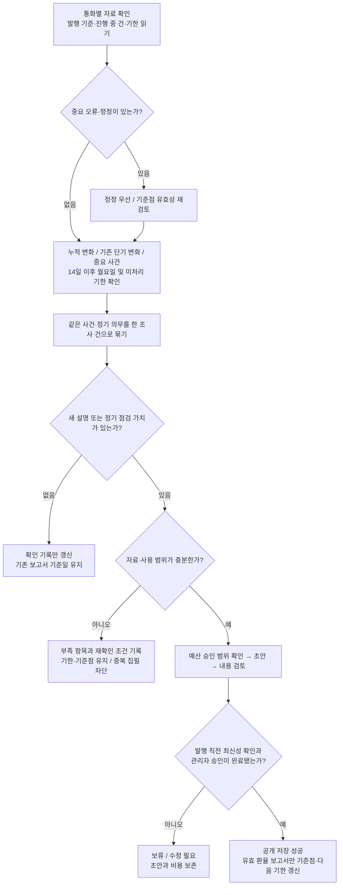

# LATAM FX 2.0 — 발행 주기 상세 설계

> 2026-10-30 재확인: [PEN·ARS 저장 재생과 판단](pre-ui-policy-review-20261030.md), [화면 상태·행동 계약](report-state-actions-20261030.md). 여섯 통화 확정을 유지하며 최근 인계/설계도의 잘못된 미결정 표시를 정정했다.

2026-10-27 설계 / 2026-10-29 로컬 판정 구현 · 여섯 통화 정책 확정 · 운영 적용 없음

## 최신 확정 — 여섯 통화 같은 주기

2026-10-29 사용자의 후속 진행 승인으로 **PEN·ARS도 누적 절대 2%와 유효 발행 후 14일이 지난 첫 한국 월요일 점검**에 맞췄다. BRL·MXN·COP·PEN·CLP·ARS가 같은 기준을 사용한다. 점검은 조사 후보를 만들며 실제 집필·발행은 근거·신규성·품질·게시 승인 조건을 별도로 충족해야 한다. ARS 후보가 많아져도 무조건 같은 횟수로 집필하지 않는다.

가격 정책과 분리된 `six-currency-cadence/2`, 판정 `publication-cadence/2`로 기록한다. 과거 네 통화 확정/두 통화 미결정 결과는 원래 판본으로 보존한다. 새 버전의 조사 건 식별자를 옛 미결정 조사 건으로 덮어쓰지 않는다. 실행할 때 임계값을 임의 변경하는 입력은 거부한다. 실제 운영 스케줄·달력·DB는 변경하지 않았다.

동일한 저장 가격·가상의 발행 기준점/달력을 사용한 재생에서 여섯 통화 모두 정책 확정과 정기 점검을 반환했고, 반복 여섯 건을 중복 차단했다. PEN·ARS가 누적 2% 미만이어도 정기 점검 대상이 됨을 확인했다. 이는 실제 발행 이력·현지 휴일 검증이 아니며, 재생의 가상 조건은 그대로 표시한다. 여섯 통화의 기준환율 스냅샷과 기존 원고·내용 검토는 바꾸지 않았다.

최신 인계는 `.local-reports/private/six-currency-preparation-LmgDyo/`, 재생/검토 준비는 `.local-reports/private/policy-review-trial-20261029/`이다. 아래 두 통화 ‘제안/미결정’은 승인 전 비교 이력이며 새 기본 정책으로 읽지 않는다.

## 이전 로컬 구현·두 통화 확정 전 비교 — 2026-10-29

`publication-cadence/1`은 기존 공통 기준환율 스냅샷을 읽어 **조사 여부만** 반환한다. BRL·MXN·CLP·COP의 마지막 유효 발행본 대비 절대 누적 2%와 한국 날짜 기준 14일 후 첫 월요일 점검을 연결했다. 같은 발행 기준점의 누적·정기·사건 이유는 한 조사 건으로 묶고, 같은 날 같은 입력의 반복 실행은 차단한다. 검토 대기·실패·역사 사례·문체 편집·정책 전용 원고·정정 원고는 가격 점검 기준점을 재설정하지 않는다. 철회한 최신 원고는 이전 유효 기준점으로 돌아간다.

휴일을 추측하지 않는다. 호출자가 확인한 `expectedReferenceDate`와 저장 가격 날짜가 맞아야 한다. 날짜 경과 경고만 있는 값은 이 일정에 맞으면 점검에 사용할 수 있지만, 보간·수집시각 오류·값 수정·가격 정의/알려진 공급자 변경은 보류한다. 일정 미확인도 자료 대기다. 이 로컬 구현이 국가별 실제 휴일·공급자 배포 달력을 확보했다는 의미는 아니다. 공유 가격 검사와 대시보드 값은 바꾸지 않았다.

정정 대상은 저장·승인·공개 이력이 있는 원고로 제한한다. 가격 조회가 막혀도 알려진 원고 오류와 새 정책 사건의 조사는 가능하다. 조사 허용은 유료 호출이나 게시 승인과 다르며 자동 집필·게시·이력 변경은 전혀 수행하지 않는다.

### PEN·ARS: 결정 전 비교 결과

| 저장 관측 범위 | 통화 | 2% + 정기 점검 | 3% + 정기 점검 | 4% + 정기 점검 |
| --- | --- | ---: | ---: | ---: |
| 최근 252개 유효 관측 | PEN | 24 | 24 | 24 |
| 최근 252개 유효 관측 | ARS | 36 | 27 | 27 |
| 최근 756개 유효 관측 | PEN | 77 | 76 | 76 |
| 최근 756개 유효 관측 | ARS | 99 | 88 | 83 |

**실제 숫자에 가상의 즉시 승인·발행을 적용한 점검 횟수**다. 마지막 관측은 2026-09-11이며 최신 10월 시장이나 실제 발행/비용 예측이 아니다. 공급자·관측시각·당시 뉴스/승인·공식 휴일 정보가 없어 중요 사건 누락률과 실제 발행 빈도는 입증하지 못한다. 최신 저장 자료에서 10/9 숫자와 가상의 발행/수집 메타데이터로 만든 별도 재생도 구분해 보존했다. 그 재생에서는 누적·정기 중첩과 6통화 동일 입력 재실행 차단을 확인했다. 처음 잘못 구성한 가상 기준점이 유효하지 않아 bootstrap으로 반환된 결과도 보존하고 성공 근거로 세지 않았다.

**제안:** PEN·ARS도 공통 조사 임계값 2%로 시작할 수 있다. PEN은 정기 점검 영향이 크고 ARS는 더 자주 조사 후보가 생긴다. 자료·신규 설명·중복 검사로 실제 집필을 선별한다. 다만 사용자 확정 전이므로 두 통화의 기본값은 `decision_pending`이다. 2·3·4%는 명시적 `saved_replay`에서만 비교하며 운영 정책으로 승격하지 않는다.

### 재현과 검증 경계

- 로컬 명령: `npm run report:cadence -- --input <비공개 manifest.json>`. 모드·고정 데이터·명시적 발행 이력·달력·대상 통화를 입력한다. 출력은 새 비공개 폴더에 저장하며 기존 이력을 쓰지 않는다.
- 입력과 결과: `.local-reports/private/continuous-readiness-20261029/cadence-miIbvC/`; 과거 숫자 연구: `.local-reports/private/cadence-replay-20261027-0F6QrF/`.
- 자동 검사는 누적 소폭 변화, 반올림 경계, 월요일 이후 보류 지속, 중복, 실패/철회, 명시적 휴일 일정, 가격 수정, 정정·사건 독립 조사, 미결정 정책을 확인한다. 실제 사건 누락과 새 원고 품질의 합격 표본은 아니다.
- 미완료: PEN·ARS 정책 결정, 실제 발행 이력/달력 저장소 연결, 일정 제공자의 정상·실패 경로 확인, 운영 스케줄과의 연결. 국가별 가격·휴일 정의 확인 없이 최신 정상으로 표시하지 않는다.

아래는 보존한 상세 설계다. 새 구현의 완료 범위와 미완료 경계는 이 절을 우선한다.

관련 문서: [현재 기준과 남은 작업](report-service-baseline-20261027.md), [두 흐름도](report-service-flows-20261027.html).

검토 이력: [2%·3%·4% 재생](publication-cadence-replay-20261027.md), [네 통화 2% 재생](publication-cadence-four-currencies-2pct-20261027.md). 초기 3%는 평가안으로 보존하고, 후속 사용자 결정으로 2%를 채택했다. 최적성 입증이나 운영 적용 승인은 아니다.

콘텐츠 제안: [짧은 정기 점검본 구성](periodic-report-content-20261027.md).

## 1. 결정 범위와 권장안

**사용자 확정 기준:** CLP·MXN·BRL·COP에 마지막 정상 환율 점검 보고서 이후 절대 누적 **2%**와 **2주 미발행 후 정기 점검**을 적용하는 방향으로 진행한다. 기존 급변·중요 사건 경로를 유지한다. 중복 발행을 막고 휴일·자료 부족을 구분한다. 내용 검토와 관리자 승인은 생략하지 않는다.

**채택한 일정 정의:** 한국시간 날짜 기준 발행 후 14일이 지난 첫 월요일에 정기 점검한다. 월요일이면 당일이다. 네 통화·누적 2%·이 일정은 문서 기준으로 확정하고, 아래 세부 예외 처리와 콘텐츠 구성은 구현 전 검토 대상으로 유지한다. 운영 설정은 변경하지 않았다.

핵심은 **점검은 규칙적으로, 집필은 필요할 때, 발행은 승인 후**다. 임계값이나 날짜가 도래하면 조사를 시작한다. 비용을 즉시 쓰거나 게시를 보장하지 않는다.

| 계기 | 판단 | 역할 |
| --- | --- | --- |
| 마지막 발행본 대비 누적 변화 | 같은 가격 기준의 절대 변화가 2% 이상 | 매일 작은 변화가 쌓이는 상황 포착 |
| 일간·5·20관측일 변화 | 기존 로컬 판정 기준 유지 | 급변·중간 반전·구간별 변화 포착 |
| 중요한 정책·시장·소비 사건 | 가격 조건과 독립적으로 새 설명의 필요성 검토 | 가격 변화가 작아도 중요한 발표를 놓치지 않음 |
| 장기 미발행 | 유효 발행일 + 14일 이후 첫 월요일 | 짧은 정기 점검본을 검토할 계기 |
| 기존 보고서 오류·중요한 반대 근거 | 일반 발행보다 우선하여 재검토 | 정정·철회·독자 안내. 새 유료 집필의 자동 허가는 아님 |

## 2. 무엇을 ‘마지막 발행본’으로 세는가

기준은 통화별로 관리한다. CLP를 발행했다고 BRL·MXN·COP의 시계가 초기화되지 않는다. 승인 버튼을 누른 순간이 아니라 **승인된 공개 결과가 정상 저장된 시각**이 발행시각이다. 공개 저장 실패는 발행 성공으로 기록하지 않는다.

혼동을 막기 위해 아래 기록을 분리한다.

| 기록 | 뜻 | 갱신 조건 |
| --- | --- | --- |
| 일반 발행 이력 | 해당 통화의 모든 승인 공개본 | 어떤 종류든 실제 공개 저장 성공 |
| 환율 점검 기준 보고서 | 현재 환율과 이전 설명을 검토한 마지막 정상 공개본 | 최신 이용 가능한 비교 가능한 환율을 포함한 시장 리포트 또는 정기 점검본 |
| 가격 기준점 | 위 보고서에 고정된 가격·실제 관측일·공급자·가격 종류·단위·자료 버전 | 새 환율 점검 기준 보고서가 공개됐을 때 |
| 정기 점검 기준일 | 환율 점검 기준 보고서의 발행시각을 한국 날짜로 변환한 값 | 위 보고서 공개 성공 때만 |
| 최근 점검 기록 | 언제 확인했고 무엇이 부족하거나 달라졌는가 | 자료 확인마다 갱신 가능. 보고서 날짜와 다름 |
| 진행 중 조사·초안 | 어떤 계기와 근거를 이미 처리 중인가 | 조사·집필·검토 상태 전환 때 |

**정책 소식만 있고 현재 환율을 점검하지 않은 글은 일반 발행 이력에만 추가**하는 안이다. 이를 환율 기준 보고서로 세면 환율을 갱신하지 않고도 누적 변화와 정기 점검이 계속 미뤄질 수 있다. 따라서 이 문서의 ‘2주 미발행’은 정확히는 **환율을 포함한 유효 보고서가 14일 이상 없었던 상태**다. 이 예외 정의도 채택할 설계 항목이다.

다음은 두 기준을 초기화하지 않는다: 생성 시도, 실패, 반려, 검토 대기, 제목·띄어쓰기·경고 문구 수정, 같은 내용 재게시, 뒤늦게 올리는 과거 사례, 최근 확인시각 표시 갱신. 과거 사례를 오늘 공개했다고 최신 환율을 설명한 것으로 세지 않는다.

## 3. 누적 변화의 정확한 정의

`누적 변화율 = 100 × (최신 유효 관측값 / 기준 보고서의 관측값 − 1)`

상승·하락 모두 절대값으로 조사 기준을 검사한다. 화면과 원고에는 원래 부호와 단위를 보존한다. `1 USD = 현지통화` 값이 증가하면 현지통화 약세 방향이다. 역수 환율의 등락률과 혼용하지 않는다.

| 조건 | 설계 처리 |
| --- | --- |
| 같은 통화·공급자·가격 종류·단위·비교 가능한 시리즈 | 누적 계산 가능 |
| 원자료가 보간값·이월 의심값·충돌값이거나 비교 기준이 다름 | 누적 판정 미검증. 0%나 기준 미달로 기록하지 않음 |
| 공급자·시리즈·산식 변경 | 자동 이어 붙이기 금지. 비교 가능한 연결 또는 새 기준 수립 검토 |
| 원자료 수정본 도착 | 보고서에 표시한 옛 수치는 보존. 같은 자료 버전으로 재계산한 비교를 별도 검토. 수정 때문에 생긴 차이를 시장 움직임으로 발행하지 않음 |
| +0.3%씩 10관측일 상승 | 약 +3.04%로 조사 후보. 변화율을 단순 합산하지 않음 |
| +2.1%가 된 뒤 다음 날 +2.2% | 같은 기준점·방향의 진행 중 조사에 기록. 새 유료 호출을 만들지 않음 |
| +2.1% 뒤 +1.8%로 복귀 | 진행 중 가격 후보에 복귀 사실 기록. 집필 전이면 가격 계기는 비활성화하고 다른 사건·정기 계기가 남는지 확인 |
| 같은 기준점에서 반대 방향 -2% 도달 | 새로운 반전 계기로 기존 조사와 함께 검토. 독립적인 자동 추가 집필은 아님 |

기준을 넘었다고 ‘원인이 새로 확인됐다’고 판단하지 않는다. **누적 변화는 발견 계기이고, 사건·기사·시장 경로의 새 설명은 별도 검토**한다. 같은 원인의 지속이라는 결론도 기간에 맞는 자료 확인이 필요하다.

기준점 대비 순변화만 보면 왕복 움직임이 상쇄될 수 있다. 예를 들어 크게 올랐다가 돌아온 경우 누적 변화가 작아도 기존 일간·5·20관측일과 사건 경로에서 검토한다. 누적 기준으로 기존 경로를 대체하지 않는다. 기사 수나 URL 교체를 새 사건으로 세지 않는다.

## 4. ‘2주’와 월요일의 정확한 정의

확정한 일정 정의는 **한국시간 달력 날짜 14일**이다. 10영업일이나 336시간 경과로 섞어 계산하지 않는다.

1. 마지막 환율 점검 기준 보고서의 한국시간 발행 날짜를 구한다.
2. 여기에 14일을 더한다.
3. 그 날짜가 월요일이면 당일, 아니면 그 뒤 첫 월요일을 정기 점검 예정일로 잡는다.
4. 예정일의 자료 확인 작업에서 점검한다. 정확한 시각은 공급자 자료 도착 조건 확인 후 결정하며 기존 정기 작업 시각을 그대로 발행시각으로 가정하지 않는다.

| 합성 날짜 예 | 다음 점검 예정일 |
| --- | --- |
| 2026-10-05 월요일 발행 | 2026-10-19 월요일 |
| 2026-10-09 금요일 발행 | 14일 후인 10월 23일 이후 첫 월요일, 2026-10-26 |
| 10월 26일 점검 예정이지만 10월 23일 새 유효 보고서 발행 | 기존 예정 취소. 새 기준으로 2026-11-09 월요일 |

따라서 최초 예정일까지는 발행 후 **14~20일**이며, 정확히 14일마다 발행하는 약속이 아니다. 자료·승인 지연으로 실제 발행은 더 늦을 수 있다. 이는 ‘2주간 조용하면 그다음 월요일에 점검’하도록 이번에 채택한 일정이다.

예정일에 점검을 끝내지 못하면 해당 건을 **기한이 지난 대기 건**으로 유지한다. 다음 정상 자료 확인 때 이어 가며 새로운 다음 월요일 건을 추가로 만들지 않는다. 작업 장애로 월요일 실행 자체가 없었어도 화요일에 미처리 예정일을 찾아야 한다.

정기 점검이 끝났지만 근거·승인 부족으로 발행되지 않았다면 발행 기준일은 그대로다. 유료 호출 없이 부족 항목과 다음 재확인 조건만 기록한다. 7일 넘게 지연되면 담당자에게 원인·미해결 항목을 한 차례 요약하고, 이후에는 상태가 달라졌을 때만 추가 알린다는 안을 권장한다. 알림 구현·전송 채널 결정은 별도다.

## 5. 휴일·시간대·가격 도착

**한국시간은 점검 일정에만 사용한다.** 환율은 해당 국가의 실제 거래일, 기사는 발표시각과 해당 지역 시간대, 통계는 대상 기간을 따로 보존한다. 국가별 여름시간을 고정 UTC 오프셋으로 추정하지 않는다.

| 상황 | 처리 |
| --- | --- |
| 한국 월요일, 현지는 아직 일요일 | 공급자가 정상 제공한 최신 완료 거래일 자료로 점검 가능. 월요일 환율이라고 표시하지 않음 |
| 현지 월요일·직전 금요일 등이 공식 휴일 | 확인된 휴장 일정과 공급자 공표 규칙에 따라 마지막 정상 거래일 사용. 휴일 자체가 오류는 아님 |
| 한국 휴일 | 자료 점검은 예정대로 가능. 관리자가 부재하면 승인 대기. 자동 게시로 우회하지 않음 |
| 현지 거래는 끝났으나 해당 가격이 아직 공표되기 전 | 정상 공표 대기. 이미 보유한 값이 ‘최신 이용 가능’인지 표시하고 예정 도착 후 재확인 |
| 공표돼야 할 자료가 아직 없음 | 자료 지연. 오래된 값으로 최신 정상 보고서를 만들지 않음 |
| 현지 휴장·공표 일정이 미확인 | 휴일로 추정하지 않고 가격 최신성 미검증. 정책 원문 검토 등 무관한 작업만 계속 |
| 주말의 중요한 정책 발표 | 발표 자체는 조사 가능. 발표 뒤 환율이 없으면 가격 반응을 주장하지 않음 |

‘며칠 지났는가’ 하나만으로 오래된 가격을 판단하지 않는다. **해당 시점에 공표되어 있어야 하는 마지막 관측**과 비교한다. 시리즈마다 거래일과 적용일이 다르면 그 차이를 명시한다. 현재 코드의 4일 지연 표시를 완성된 휴일 판정으로 간주하지 않는다.

## 6. 정기 점검본에는 무엇을 쓰는가

큰 사건이 없는 기간에는 장문의 원인 분석 대신 **짧은 정기 점검본**을 권장한다.

- 마지막 발행본 이후 환율이 얼마나 달라졌는지, 실제 비교 날짜와 가격 기준.
- 이전에 설명한 요인 가운데 무엇이 유지·변경·미확인 상태인지.
- 확인된 다음 주요 발표·일정과 어떤 설명을 점검하는 데 필요한지.

‘새로운 원인이 없다’와 ‘새로운 원인을 확인하지 못했다’는 다르다. 검색·공식 자료 확인이 정상적으로 이루어졌을 때만 검토 범위 내에서 새 설명의 유무를 판단한다. 수집 실패 중에는 시장이 조용하다고 결론 내리지 않는다.

현재 수치와 일정만 확인 가능하다면 이를 사실 중심의 짧은 점검본 후보로 준비할 수 있다. 이전 원인 설명을 그대로 가져와 오늘도 유효하다고 주장하지 않는다. **새 경제 사건이 없어도 비교 정보와 점검 결과가 독자에게 유용하면 발행 가능**하지만, 날짜만 바꾼 복제 원고는 만들지 않는다.

이 유형은 환율 원인 분석과 이름·목적을 구분한다. 원인 분석의 근거 검사를 느슨하게 해서 정기 점검본으로 통과시키지 않는다. 정기 점검용 평가 기준은 정확성·기간·점검 범위·읽을 가치 중심으로 별도 설계하고 기존 원인 분석 점수와 한 합격률로 합치지 않는다. 고정 사실을 코드로 표시하는 방식과 AI 요약의 필요 여부는 후속 설계이며 매번 유료 집필해야 한다고 정하지 않는다.

## 7. 중복·대기·동시 실행 처리

두 층으로 중복을 관리한다. **같은 요청의 중복 실행**은 코드가 차단하고, **같은 사건을 다시 설명하는 중복**은 근거와 기존 원고를 비교해 판단한다. 해시가 다르다는 이유만으로 새 설명이 되지는 않는다.

| 상황 | 권장 처리 |
| --- | --- |
| 누적·일간·정기 조건이 같은 날 충족 | 통화별 한 조사 건에 모든 계기 기록. 하나의 초안으로 필요한 범위를 다룸 |
| 같은 기사가 다른 매체에 재전송되거나 주소만 바뀜 | 동일 사건·주장으로 묶음. 독립 근거나 새 집필로 세지 않음 |
| 조사 중 새 근거 도착 | 조사 자료 버전 추가. 이전 근거·판정 보존 |
| 승인 대기 중 새 사건 도착 | 기존 초안의 유효 범위 재검토. 새 사실을 붙여 승인하지 않으며 수정 필요 또는 후속 후보로 분리 |
| 동일 자료로 품질 탈락 | 실패 문장·원인 보존. 날짜 변경이나 새 실행 ID로 자동 재작성하지 않음 |
| 시간 초과·응답 유실·비용 미확인 | 호출·예약 유지, 해당 건의 추가 유료 호출 보류. 오프라인 자료 확인 계속 |
| 두 작업이 동시에 같은 후보를 처리 | 한 작업만 생성권 확보. 나머지는 진행 중 결과를 조회. 저장·호출 직전에도 재확인 |
| 두 관리자가 같은 원고를 승인 | 공개 복사·승인 기록·발행 기준 갱신은 한 번만. 나머지는 명시적 중복 처리 |

초기 자동 집필 경로는 **통화별 한국 날짜당 신규 집필 최대 1회**를 권장한다. 단 이는 운영 호출 예산이 승인된 뒤의 최대치이며 현재 호출 권한은 아니다. 같은 날의 추가 유료 재시험은 별도 결정이 필요하다. 즉시 필요한 오류 안내·철회는 유료 집필을 기다리거나 하루 상한 때문에 지연시키지 않는다.

점검 작업이 반복 실행되어도 새로운 조사 건을 매일 만드는 대신 동일한 미해결 건을 이어간다. 누적 기준을 잠시 벗어났다 재진입해도 같은 기준 보고서·같은 방향·같은 사건이면 기존 건에 연결한다. 새로운 근거, 반전, 기존 설명을 바꾸는 사건은 재검토 사유로 기록하되 자동 추가 호출 사유로 쓰지 않는다.

## 8. 발행 직전 확인과 기준점 갱신

1. 초안의 자료·규칙 버전과 검토 대상 본문이 그대로인지 확인한다. 다른 초안으로 승인 대상이 바뀌면 기존 검토를 재사용하지 않는다.
2. 최신 이용 가능한 가격·사건이 초안의 범위와 달라졌는지 확인한다. 최신 가격으로 숫자·차트만 조용히 바꾸지 않는다.
3. 새 가격 관측이나 중요한 사건이 추가됐다면 재검토 대기로 둔다. 내용이 여전히 유효하다는 판단 없이 ‘최신’으로 게시하지 않는다. 필요하면 별도 수정본·재검토를 만들며 유료 재생성은 자동으로 하지 않는다.
4. 과거 시점 자료로 발행할 경우 역사 사례로 표시하고 누적·정기 기준점 갱신 대상에서 제외한다.
5. 공개 저장과 기준점 갱신을 일관되게 처리한다. 일부만 성공하면 재처리가 같은 결과를 회복하도록 설계하며 두 번 발행하지 않는다.

검토 지연 중 가격이 달라진 경우를 줄이려면 작성·검토 시간을 자료 공표 주기에 맞춰야 한다. 이는 운영 담당자·확인 시점을 정할 때 검토하며, 기준을 낮춰 해결하지 않는다.

**기준 보고서가 잘못됐거나 철회된 경우:** 정상 추천과 기준점에서 제외한다. 직전의 정상·비교 가능한 보고서로 되돌릴 수 있으면 그 값과 원래 발행일을 사용하고, 철회 시각을 새 기준일로 쓰지 않는다. 없으면 기준 없음 상태로 전환한다. 원자료 수정·산식 변경은 시장 급변과 분리해 정정 검토한다. 가격을 그대로 두는 문구 교정은 기존 기준점·기한을 유지한다.

**첫 보고서가 없는 경우:** 0%나 14일 대기를 만들지 않는다. 초기 기준 수립 후보로 조사한다. 충분한 자료와 승인 후 첫 유효 공개본에서 기준을 만든다. 현재 모델 비교 원고를 자동으로 첫 발행본으로 등록하지 않는다.

## 9. 상태 표시와 자료 부족의 처리

| 내부 판단 | 독자가 볼 상태 | 기준점·기한 |
| --- | --- | --- |
| 정상 확인, 새 설명 불필요 | 기존 보고서 + 별도의 최근 확인일 | 유지 |
| 가격 변화 확인, 원인 기사 부족 | 배경 확인 중 | 유지, 조사 건 계속 |
| 정기 기한 도래, 자료 부족 | 정기 점검 대기 · 자료 지연/부족 | 기한 지난 건 유지 |
| 자료는 있으나 권리·재사용 범위 미확인 | 자료 검토 중 | 사용 범위 해결 전 입력·공개 보류 |
| 초안 생성, 내용 또는 관리자 검토 대기 | 검토 대기 | 초안 비공개, 기준 유지 |
| 오류 확정·철회 | 기존 보고서 정정/철회 안내 | 잘못된 기준 제외 |
| 새 유효 보고서 공개 성공 | 실제 기준일·관측일을 표시한 새 보고서 | 가격 기준점·정기 일정 갱신 |

공개 조회 장애 때는 마지막 정상 공개본을 캐시·기준일과 함께 제공할 수 있지만, 알려진 정정·철회 상태가 캐시보다 우선한다. 최신 정정 상태조차 확인할 수 없으면 확인 불가를 표시하며 정상 최신이라고 단정하지 않는다. 초안을 장애 대체 공개본으로 쓰지 않는다.

## 10. 전체 판단 흐름

아래는 설계 도식이며 자동 실행된 결과가 아니다.

## 11. 구현 전 대조할 사례

다음은 **설계의 예상 처리 표**이며 실행 테스트·역사적 성능 검증 결과가 아니다.

| 사례 | 기대 판단 | 방지할 오류 |
| --- | --- | --- |
| 매일 +0.3%씩 10관측일 | 누적 약 +3.04%, 조사 후보 | 일간 기준만 보고 누락 |
| 누적 -2.1% | 강세 방향 후보 | 상승만 포착 |
| +2.1% 이후 사흘 연속 기준 초과, 새 근거 없음 | 같은 조사 건 대기 | 매일 같은 원고 생성 |
| +2.1→+1.8→+2.2%, 사건·근거 동일 | 같은 건 이력 갱신 | 재진입을 신규 호출로 사용 |
| 큰 상승 뒤 원점 복귀 | 단기·반전·사건 경로 검토 | 순누적 0%를 무변동으로 오인 |
| 정기 월요일에 누적·중요 발표도 충족 | 하나의 초안에 범위 통합 | 리포트 세 건 생성 |
| 정기 예정 전 새 유효 보고서 공개 | 새 기준으로 일정 재산정 | 불필요한 정기본 즉시 발행 |
| 최근 정책 소식만 공개, 현재 환율 미점검 | 정책 이력만 추가, 환율 점검 기한 유지 | 무관한 글로 기한 무한 연장 |
| 현지 연휴, 마지막 정상 관측은 목요일 | 확인된 공표 일정상 최신이면 사용·거래일 표시 | 임의 금요일 값 생성 또는 무조건 지연 판정 |
| 예정 공표 지나도 가격 없음 | 자료 지연, 기한 대기 | 오래된 값으로 최신 발행 |
| 월요일 작업 장애, 화요일 복구 | 미처리 정기 건 이어가기 | 다음 월요일까지 누락 |
| 8월 소비 통계만 있고 10월 급변 원인 없음 | 소비 범위 분리, 급변 배경 대기 | 월간 통계로 당일 원인 대체 |
| 정상 자료·일정 확인, 새 사건 없음 | 사실 중심 정기 점검본의 읽을 가치 검토 | 억지 원인 추가 또는 단순 날짜 복제 |
| 승인 대기 중 새 가격·사건 도착 | 최신성 재검토 | 오래된 초안 자동 승인 |
| 중복 작업·동시 승인 | 호출·공개·기준 갱신 한 번 | 이중 비용·이중 게시 |
| 실패·반려·문체 수정·과거본 등록 | 누적 기준·정기 기한 유지 | 시계 초기화 |
| 기준 원고 철회·공식 가격 수정 | 정상 기준 복원 또는 기준 없음, 수정 영향 검토 | 허위 급변·오류 캐시 재노출 |
| 새 공개 저장 실패 | 발행 미완료, 이전 기준 유지 | 게시되지 않은 글을 기준으로 계산 |

과거 재생에서는 통화별 누락·중복·조사 후보·실제 근거 확보·발행 가능성을 나눠 센다. 2%·3%·4% 등 누적 평가값을 비교할 수 있으나 발행량 목표에 맞추어 임계값을 임의로 조정하지 않는다. **발행 후 기준점이 바뀌는 구조이므로 실제 발행 이력 또는 명시적으로 가정한 발행 시나리오가 필요하다.** 가상의 승인 시점을 넣은 재생을 실제 운영 발행 빈도로 보고하지 않는다. 미래 기사·수정 통계를 당시 자료처럼 사용하지 않는다.

## 12. 다음 작업과 남는 결정

네 통화 2% 저장 수치 재생은 완료했으며 실제 사건·공식 가격·휴장 검증은 남아 있다. 다음에는 짧은 정기 점검본의 구성과 독자 가치를 검토한다. 콘텐츠 검토는 Astra High, 후속 구현은 Sol High를 권장한다.

네 통화·누적 2%·한국 날짜 14일 후 첫 월요일은 채택됐다. 정책 단독 글과 환율 점검 기준 보고서의 예외 처리, 정기 점검본의 짧은 형식·평가 기준은 후속 검토한다. 운영 전에는 국가별 공표·휴장 자료, 확인 시각, 검토 담당자, 월 예산과 호출 상한을 확정해야 한다.

기존 `publication-policy.md`의 정기 강제 발행 제외, `generation-decision-plan.md`의 독립 누적 기준 제외는 당시 설계 기록으로 보존한다. 본 문서의 누적 2%·정기 점검은 **후속 사용자 확정 기준**으로 우선한다. 강제 발행은 여전히 하지 않는다. 현재 코드는 여전히 기존 로컬 판정이며 이번에는 파일럿·외부 자료·모델 호출·앱·정기 작업·운영 DB를 변경하거나 실행하지 않았다.
