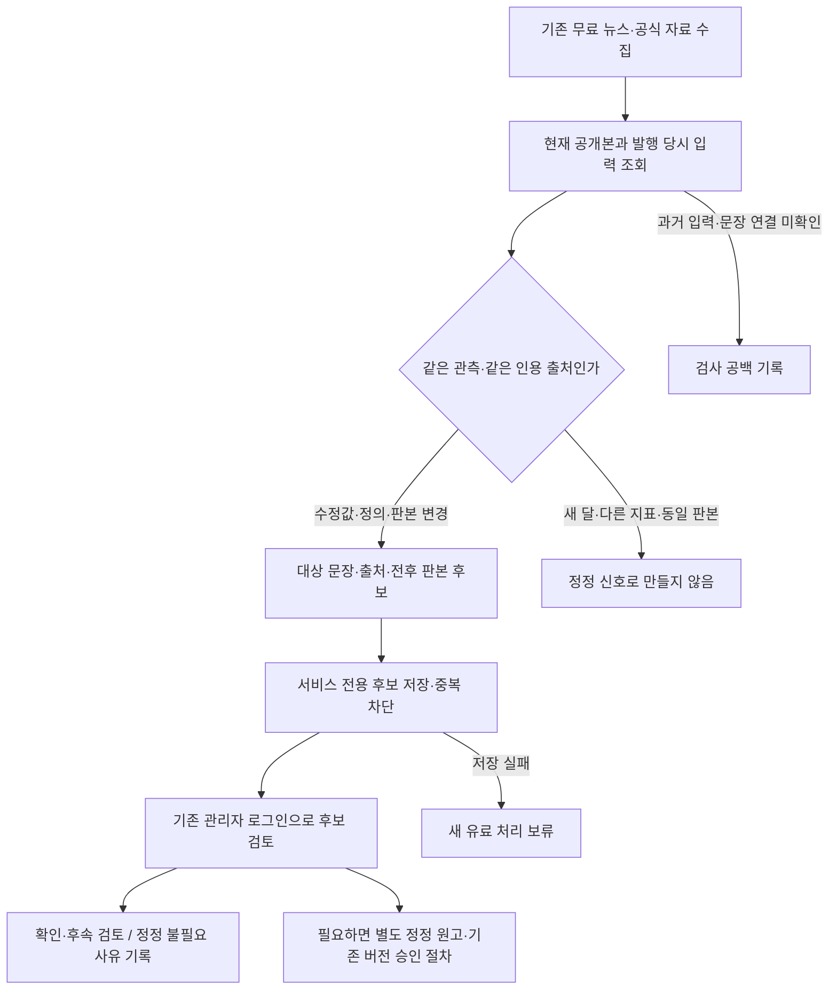

# 4단계 — 공개 리포트 정정 후보 자동 연결

2026-11-01 · 로컬 구현·저장 자료 검증 · 기존 원고/환율/운영 보존

## 이번 결과

새 자료를 무료로 확인하는 기존 공통 운영 경로에 **변경 신호 → 대상 문장·출처·판본 연결 → 비공개 DB 기록 → 기존 관리자 검토**를 연결했다. 공개 원고를 고치거나 철회하거나 새로 승인하는 기능이 아니다. 실제 모델 호출과 비용은 0이다. 새 저장 구조는 `latamfx-2x-isolated` 로컬 DB에만 적용했다.

| 변경 신호 | 후보로 기록하는 조건 | 자동으로 결론 내리지 않는 것 |
|---|---|---|
| 공식 수치 수정 | 같은 통화·계열·정의·단위/비교 방식·대상 월의 검증값이 발행 당시 값과 다름 | 당시 원고가 잘못됐다는 결론. 사후 통계 수정일 수 있음 |
| 공식 정의 변경 | 같은 계열·대상 월이지만 정의/버전/범위가 달라 직접 비교할 수 없음 | 서로 다른 기준의 수치 차이를 증감으로 계산 |
| 인용 기사 판본 변경 | 기존 근거와 같은 URL의 검증된 본문·발표/수정 정보 해시가 바뀜 | 본문 의미가 반대로 바뀌었다는 결론. 단순 편집일 수 있음 |

새 달 통계, 다른 지표/다른 기간, 수집시각만 바뀐 자료, 수치의 미세한 부동소수점 차이를 정정으로 처리하지 않는다. 같은 문장의 같은 출처·전후 판본 신호는 다시 확인해도 기존 기록을 유지한다. 한 문장이 여러 수정 지표를 인용하면 출처/지표별 신호는 구분해 보존한다. 이는 서로 다른 증거이며 원고 수나 품질 표본 수가 아니다.

## 흐름과 기존 운영과의 관계



- 가격 갱신·발행 임계값과 독립된 무료 확인 단계다. 새로운 FX 관측이 없어도, 과거 배치가 완료됐어도 실행한다.
- 기존 대시보드 값·휴일 이어받기·2% 누적/정기 점검 기준·메일 동작을 바꾸지 않았다.
- 후보 확인은 게시 승인과 다르다. 검토자가 ‘확인’해도 공개 원고·기준일·차트·출처는 그대로다.
- 후보 저장 실패, 이력 조회 실패, 검사 입력 실패는 실행 결과와 조치 필요 상태에 남기고 추가 유료 처리를 보류한다. 수집·화면 조회까지 중지시키지는 않는다.
- 운영 코드를 반영할 때에는 이 migration을 먼저 준비해야 한다. 미적용 상태를 정상 저장 성공으로 간주하지 않는다. 이번에는 운영에 적용하지 않았다.

## 실제 저장 형식에서 보완한 점

일부 기존 공식 입력은 정의 ID와 버전은 저장했지만 세부 범위 객체를 저장하지 않았다. 합성 자료만으로 이 연결을 검증하지 않고 실제 저장된 6통화 입력 형식을 재생했다.

- 기존 ID·버전이 현재 등록된 정확한 지표 정의와 일치할 때만 범위를 복원한다.
- 과거 정의를 확인할 수 없으면 `published_indicator_definition_unavailable`로 남긴다. 현재 국가 기본값을 과거 정의로 추정하지 않는다.
- 앞으로의 내부 공식 통계 스냅샷에는 범위 객체도 함께 보존한다. 과거 원고나 당시 입력은 다시 쓰지 않는다.
- 과거 입력의 직렬화 바인딩, 현재 기사 카드 바인딩, 공식 수치 검사 결과의 바인딩을 확인한다. 연결이 끊긴 자료로 정정 후보를 승인하지 않는다.

## 저장·권한·관리 화면

`app_private`의 후보·검토 감사·통화별 마지막 검사 표를 분리했다. 후보는 최대 16KB, 한 통화 한 번의 검사 결과는 최대 100후보, 전체 후보 용량은 50MB로 제한한다. 초과는 보류로 드러내며 자동 삭제·자르기·기존 기록 덮어쓰기는 하지 않는다. 현재 공개 이력 조회는 기존 1,000건 범위이며 상한에 닿으면 검사 범위 제한을 표시한다.

- 서비스는 후보를 추가할 수 있으나 기존 후보/관리자 판단을 덮어쓸 수 없다.
- 일반 로그인·익명 사용자는 후보를 조회하거나 판단할 수 없다. 관리자도 원자료 표에 직접 접근하지 않고 제한된 RPC를 사용한다.
- active admin을 매 요청 DB에서 다시 확인한다. 비활성화된 관리자는 같은 세션에서도 차단한다.
- 판단 사유와 버전을 기록한다. 동시 검토의 오래된 버전은 거부하고 이전 판단도 감사 기록에 보존한다.
- 공개본이 교체·철회되면 후보는 ‘대상 공개본 교체·철회됨’으로 보인다. 지우거나 정상 현재 원고처럼 다루지 않는다.
- 기존 관리자 화면에 ‘공개 리포트 재검토’, 문장·대상 공개 ID 링크·변경 출처·전후 수치·최근 판단 사유를 연결했다. 30건 단위로 이전/다음 후보를 조회한다.
- 로그아웃·권한 해제·창 비활성화·연결 실패 시 기존 비공개 상태 제거 경로에 후보와 입력한 사유도 포함했다.

## 검증 결과와 구분

| 검증 | 결과 |
|---|---|
| 공통 단위·회귀 | 6통화 공통 수정값, 새 월/반올림/수집시각 오탐 방지, 정의 변경, 같은 기사 판본, 잘못된 바인딩, 역사/시험/철회 제외, 저장 실패 후 무과금 중단, 완료 배치 뒤 재확인 |
| 실제 저장 형식 + 합성 수정값 | 기존 6통화의 실제 정의/입력 형식에 **가상의 수정값**을 적용. 후보28개 생성·DB 저장·동일 신호 중복28개 유지·관리자 확인28개. 전후 공개 본문6개 불변. 전체 트랜잭션 롤백 |
| 실제 저장 자료 그대로 재생 | 기존24기사·공식9수치의 무과금 공통 진입점과 격리 REST 기록 연결 확인. **비교 대상인 운영 발행본0건**이므로 실제 오류 발견률이나 ‘정정 불필요’ 판정으로 세지 않음 |
| 권한·감사 | 새 pgTAP27검사 통과. 전체 DB13파일249검사 통과. 일반 로그인/익명 차단·관리자 즉시 해제·동시 검토·대상 철회·원고 불변 확인 |
| 전체 코드 | 162파일1,191사례와 타입·린트·운영/앱/리포트 빌드·번들 검사. 테스트 수를 실제 경제 원고 품질 표본으로 세지 않음 |
| 비밀값·DB 점검 | 브라우저 산출물108파일 비밀/비공개 기록 노출0. 격리 로컬 CLI 보안·성능 advisors 경고0 |
| 브라우저 | 기존 로컬 관리자 화면의 로그인 전 비공개 영역 차단 확인. 이번에는 실제 관리자 로그인 후 후보를 클릭하지 않았으며, 관리자 판단은 격리 DB RPC로 확인 |

합성 원고는 기존 실제 원고로 교체하지 않았다. 최초 합성 자료의 공개 필드 부족과 공개 투영 전/후 비교 기준 차이에서 발생한 시험 설정 오류를 수정했다. 제품의 공개 허용 필드나 권한 검사는 완화하지 않았다. 미사용 테스트 변수 린트 오류도 정리했다.

## 명시적인 검사 한계

1. 이 무료 검사는 **구조적으로 연결된 수정값·인용 판본 변경**을 찾는다. 서로 다른 기사의 의미상 반박, 새 정책으로 해석의 타당성이 달라진 경우, 제목·요약의 문장별 근거가 보존되지 않은 경우를 의미 검사 없이 통과시켰다고 말하지 않는다.
2. 현재 수집·검증된 동일 대상 월만 비교한다. 원자료에 없어 확인하지 못한 과거 월의 수정 여부나 모든 과거 발행본 전체를 검사했다고 말하지 않는다.
3. 카드/통계 부족·과거 입력 부족·문장 연결 미확인·역사/시험 제외·이력 상한은 별도 범위로 기록한다. 후보0건은 경제 설명의 무오류 보증이 아니다.
4. 공식 통계는 계속 소비·금융 배경이다. 당일 환율 원인의 근거로 바꾸지 않는다. 수정 수치를 기준환율에 덮어쓰지 않는다.

새 유료 의미 대조나 자동 정정 집필은 이번에 호출하지 않았다. 기존 실제 생성 시험/내용 검토의 예산 승인 범위에서 별도로 검증해야 한다. 이 경계를 숨기지 않은 상태에서 다음 5단계 독립 점검으로 넘긴다.

## 주요 파일과 재현

- `scripts/currency-report/published-corrections.js`, `published-corrections.test.ts`
- `automatic-supply-plan.js`, `operating-cycle.js`, `runtime-store.js`, `official-statistic-admission.js`
- `supabase/migrations/20261101125442_currency_report_correction_candidates.sql`
- `supabase/tests/currency_report_corrections.sql`
- `src/components/CurrencyReportReview.tsx`

```text
node scripts/currency-report/verify-corrections-local.mjs --install
node scripts/currency-report/replay-corrections-local.mjs
```

두 명령은 격리 로컬 DB에 고정돼 있다. 재생 명령은 저장 자료 manifest를 사용하고 외부 자료/모델 요청을 금지한다. 설치 명령은 새 구조와 해당 RPC만 적용하며 기존 데이터·제어 값의 보존을 검사한다. 비공개 시험 자료는 `.local-reports/private/corrections-20261101/`와 `corrections-db-*`, `corrections-replay-*`, `corrections-pgtap-*`에 보존하고 Git/웹에 제공하지 않는다.

다음 고정 작업: **5단계 전체 흐름 독립 점검 — Astra High**. 이번 신호 검사의 한계, 국가별 임시 예외, 중복, 규칙 충돌, 정상 자료 과잉 차단을 함께 검토한다. 이후에만 6단계 실제 생성 시험과 7단계 출시 준비로 진행한다.
