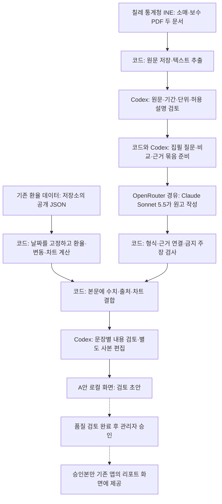
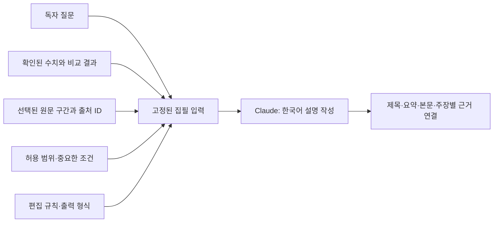

# 칠레 리포트는 어떻게 만들어지는가

2026-10-16 확인 · LATAM FX 2.0 로컬 개발 현황

## 먼저 알아둘 핵심

현재는 **공개 자료를 코드로 수집·계산하고, Codex가 원문과 설명 범위를 검토한 뒤, Claude에게 글쓰기를 맡기는 반자동 제작 과정**이다. 생성 이후에도 코드 검사, 내용 검토, 관리자 승인은 서로 별개다.

모든 단계가 매일 자동으로 이어지는 완성된 운영 작업은 아니다. 여러 로컬 명령과 이 대화에서의 검토를 이어서 실행하고 있다. 아래는 목표 설계가 아니라 현재 코드와 저장된 실행 기록을 확인한 설명이다.

이 문서의 중심 사례는 **기준일 2026-10-15인 칠레 경제·소비 환경 리포트**다. 실제 내용은 8월 통계이며, 10월 15일 환율 변동의 원인을 설명한 리포트가 아니다. 이전의 환율 원인 분석 경로와 구분해야 한다.

## 1. 한눈에 보는 현재 제작 과정

실선은 현재 제작 경로, 점선은 검토·승인을 거쳐야 하는 다음 연결이다. ‘Codex 검토’는 이 대화에서 제가 자료를 읽고 판단한 것으로, 별도의 자동 심사 서비스가 아니다.

환율 숫자와 차트는 AI가 만드는 것이 아니다. 이번 경제·소비 원고의 집필 입력에서는 일간·5관측일·월초 대비 환율 사실을 제외하고, 승인된 월별 통계 설명에 집중시켰다. 환율 정보는 화면을 구성할 때 코드가 별도로 결합한다.

## 2. 누가 무엇을 담당하는가

| 담당 | 실제 하는 일 | 하지 않는 일 |
| --- | --- | --- |
| 수집·계산 코드 | 공개 파일 수집, 날짜·단위 확인, 변화 계산, 자료 부족 판정, 입력 구성, 형식 검사, 저장 | 기사 의미나 모든 인과관계의 진위를 스스로 확정하지 않음 |
| Codex — 이 대화의 작업자 | 원문 읽기, 사용할 주장과 제외할 주장 구분, 입력 설계, 문장별 대조, 잠정 평가, 사본 편집 | 점수를 주었다는 이유만으로 게시 승인하지 않음 |
| OpenRouter | API 요청을 지정 모델 제공 경로에 전달하고 사용량·비용을 반환 | 자료를 직접 취재하거나 원고를 승인하지 않음 |
| Claude Sonnet 5.5 — 집필 모델 | 전달받은 질문·근거·허용 범위로 한국어 원고와 주장-근거 대응표 작성 | 이번 호출에서는 검색·브라우징·추가 자료 수집을 하지 않음 |
| 사용자 | 예산, 방향, 독자 관점의 평가와 채택 의사 결정 | 모든 코드 검사를 직접 수행할 필요는 없음 |
| 로그인한 관리자 | 검토 조건을 만족한 원고의 승인·반려 | 일반 사용자에게 초안·실행 원문을 공개하지 않음 |

현재 집필 호출 경로는 **로컬 Node 실행 → OpenRouter → Google Vertex 제공 경로의 Claude Sonnet 5.5 → 로컬 결과 저장**이다. Google Vertex는 제공 경로이며 집필 모델이 Gemini라는 뜻이 아니다. 이는 이번 저장 실행의 설정이지, 모든 과거 시험이나 향후 운영 모델의 확정값은 아니다.

## 3. 자료는 어디서 가져오는가

### 이번 원고에 실제 사용한 자료

| 자료 | 가져오는 곳 | 사용하는 내용 | 해석 범위 |
| --- | --- | --- | --- |
| 환율 | 프로젝트 GitHub의 특정 커밋에 고정된 `public/data.json` | CLP 환율, 실제 관측일, 변화율, 화면 차트 | 행별 정확한 관측시각은 확인되지 않음. 수집시각으로 대신하지 않음 |
| 소매 전체 | INE 상업활동 공식 PDF | 2026년 8월 소매 전체 실질·원계열 전년동월비 3.4% | 전체 소매 지표이며 회사별 판매 실적이 아님 |
| 관련 상품군 | 위와 같은 INE 소매 PDF | 넓은 전자·가정용 기술 관련 상품 분류의 같은 기준 증가율 4.7% | TV 단일 품목이나 수량·시장점유율로 확대하지 않음 |
| 실질 시간당 보수 | INE 보수 공식 PDF | 2026년 8월 실질 시간당 보수 전년동월비 3.4%와 산식 조건 | 가계 총소득·월 보수·실제 소비 지출과 동일하지 않음 |

**근거 카드 세 개는 원문 세 개가 아니다. 두 PDF에서 세 가지 지표를 뽑았다.**

원문을 찾는 공식 목록:

- [INE 월별 상업활동](https://www.ine.gob.cl/estadisticas-por-tema/comercio-y-servicios/actividad-mensual-del-comercio)
- [INE 보수와 노동비용](https://www.ine.gob.cl/estadisticas-por-tema/mercado-laboral/remuneraciones-y-costos-laborales)

이번에 사용한 문서:

- [8월 상업활동 PDF](https://www.ine.gob.cl/docs/default-source/actividad-mensual-del-comercio/boletines/2026/bolet%C3%ADn-sectores-econ%C3%B3micos-%C3%ADndice-de-actividad-del-comercio-(iac)-agosto-de-2026.pdf?sfvrsn=41c7f202_4): 저장 검토 기록상 9월 30일 발표.
- [8월 보수 PDF](https://www.ine.gob.cl/docs/default-source/sueldos-y-salarios/boletines/espa%c3%b1ol/ir-icl-base-anual-2023-100/2026/agosto-2026.pdf?sfvrsn=fdcaf8a2_4): 저장 검토 기록상 10월 7일 발표.

이 문서 작성에서는 원문을 새로 수집하지 않고 보존된 원문 검토·해시 기록을 확인했다. 후속 접근 실패 때도 저장본을 이용했으므로, 현재 원격 사이트의 개정 여부를 새로 확인했다는 뜻은 아니다.

### 구현되어 있지만 이번 집필에는 사용하지 않은 수집 경로

| 경로 | 역할 | 주의할 구분 |
| --- | --- | --- |
| GDELT 뉴스 검색 | 국가·기간·질문에 맞는 기사 후보 발견 | 검색 결과가 곧 승인된 근거는 아님 |
| Emol·Reporte Minero 사이트맵 | 칠레 시장 기사 원문 후보 찾기 | 원문·가격 시각·비교 기준 확인이 별도로 필요 |
| Alpha Vantage 뉴스 | 기존 뉴스 후보 공급 | 이번 월별 통계 원고의 입력에는 사용하지 않음 |
| 공식 경제 일정·발표 수집 | 금리·물가·소비 등 조사 계기 찾기 | 국가별 자동화 범위가 다르며 칠레 일정 확인에는 수동 경로가 남음 |

따라서 ‘기사를 두 개만 검색하도록 되어 있다’고 이해하면 안 된다. 이번 원고는 뉴스 기사 대신 검토된 통계 PDF 두 개를 사용한 사례다. Investing.com 자동 수집을 이번 경로에 연결한 상태도 아니다.

## 4. 실제 작업 순서

### ① 새로 작성할 이유가 있는지 살핀다

코드는 일간·5관측일·20관측일 변동, 정책·소비 발표 같은 사건, 이전 원고와 보류 기록을 비교한다. 변동이 크지 않아도 중요한 발표는 별도 조사 후보가 될 수 있다.

하지만 가격 기준 충족은 집필 허가가 아니다. ‘새로 설명할 내용이 있는가’는 원문을 검토한 기록이 필요하다. 현재는 Codex가 이를 검토해 판단 기록을 준비한다. 부족하면 조사 후보나 근거 대기로 남긴다.

이번 사례에서는 INE 소매 발표와 소비 환경 설명을 대상으로 검토했다. 보고서 기준일이 새롭다고 이미 지난 발표를 ‘오늘 나온 새 소식’으로 표현하지 않는다.

### ② 독자 질문을 정하고 부족한 자료를 찾는다

질문 선택·자료 부족 판정기는 보유 자료를 보고 추가 확인할 질문을 제안한다. 경제·소비 원고에서는 다음과 같은 질문이다.

- 전체 소매와 관련 상품군은 같은 방향인가?
- 실질 보수와 소매를 같은 기간 기준으로 비교할 수 있는가?
- 이 지표가 대표하는 사람·상품·판매 경로는 어디까지인가?

코드는 대상 기간, 지표, 단위, 비교 기준, 판매 경로, 실질·명목, 계절조정 여부, 기준연도를 확인한다. 누락된 자료를 찾거나 보유 자료를 다시 검토하도록 분류하지만, 그 자체로 경제적 설명의 타당성을 승인하지는 않는다.

### ③ 원문을 가져오고 읽을 수 있는 형태로 바꾼다

칠레 월별 수집기는 공식 목록에서 해당 월 PDF 링크를 찾고 원문을 저장한다. PDF 텍스트를 추출하고, 나중에 같은 원문인지 확인할 수 있도록 파일 지문인 해시를 남긴다.

텍스트 추출 성공과 수치 해석 성공은 다르다. 표의 열·주석·계절조정 구분은 Codex가 원문과 대조한다. 자동 접근에 실패하면 보존된 원문이나 수동 확인 경로를 명시하며, 최신 수집 성공으로 표시하지 않는다.

### ④ 사용할 사실과 설명 범위를 확정한다

각 자료를 ‘근거 카드’로 정리한다. 카드에는 출처, URL, 발표일, 대상 기간, 확인한 원문 구간, 지표 정의, 사용할 수 있는 주장과 넘으면 안 되는 범위가 들어간다.

예를 들어 이번 입력은 관련 상품군과 전체 소매의 **증가율 비교**를 허용하지만, 해당 상품군의 실제 판매액이 더 크거나 특정 회사의 판매가 개선됐다는 설명은 허용하지 않는다. 시간당 보수에는 근로시간 변화가 지표를 바꿀 수 있다는 중요한 조건을 남긴다.

### ⑤ AI가 쓸 입력을 만든다

입력에는 단순히 PDF 본문만 넣는 것이 아니다. 검토한 질문, 코드가 비교한 결과, 허용된 설명 범위까지 넣는다.

현재 `consumer-context/2` 입력은 ‘관련 상품군 증가율이 전체보다 높다’, ‘소매와 보수의 전년동월비가 모두 양수다’ 같은 비교를 코드가 미리 만든다. **모델은 이미 선별된 비교를 설명하는 비중이 크다.** 새 통계나 추가 배경을 스스로 찾아 설명을 넓히는 방식은 아니다.

공통 한계는 별도 영역으로, 해당 설명을 바꾸는 중요한 조건은 본문 재료로 나눈다. 검토된 관찰 변수가 없으면 빈칸을 억지로 채우지 않는다.

### ⑥ 예산을 확인한 뒤 집필 모델을 한 번 호출한다

Node 명령이 Git에서 제외된 로컬 설정의 OpenRouter 키를 읽는다. 브라우저가 키를 받거나 모델을 호출하지 않는다. 이번 경로는 모델·제공 경로·가격·개인정보 보호 조건을 확인하고, 고정 입력과 승인 예산을 묶어 호출한다.

이번 비교 호출은 Sonnet 5.5, 추론 medium, 120초 제한, 출력 최대 8,192토큰, 자동 재시도·백업 없음이었다. 같은 실행의 중복 호출을 막고 호출 전에 비용을 예약한다. 사용 비용을 확인하지 못하면 예약을 유지한다.

전송 대상은 공개 자료를 정리한 입력이다. 키는 인증에만 사용한다. 이번 경제 원고에는 관리자 이메일·변경 이력·회사 내부 판매자료·계획환율을 집필 자료로 넣지 않았다.

### ⑦ 코드가 결과를 검사하고 수치·차트를 결합한다

모델은 정해진 JSON 구조로 제목, 요약, 설명, 필요한 관찰 항목과 주장-근거 대응표를 반환한다. 코드가 형식, 존재하지 않는 근거 ID, 문장 연결, 금지 주장 등을 검사한다. 수치는 확인된 사실 ID를 이용해 코드가 표시한다.

자동 검사가 통과해도 ‘출처가 그 문장의 모든 주장을 지지한다’는 의미는 아니다. 그 판단은 다음 내용 검토에 남는다. 실패를 자동 재작성이나 다른 모델 호출로 덮지 않는다.

### ⑧ 원고를 원문과 대조하고, 필요하면 별도 사본을 다듬는다

Codex가 제목과 문장별로 근거를 대조하고 다음을 나눈다.

- 반드시 고칠 오류: 틀린 수치·기간·귀속·인과관계·설명 범위 확대.
- 편집 개선: 추상적인 제목, 중복 표현, 과도한 반복 경고, 읽기 어려운 수치 라벨.

이번 최신 비교의 내용 평가는 Codex의 잠정 비블라인드 평가다. 독립된 외부 검토 모델을 한 번 더 호출한 결과가 아니다. 수동 편집은 새 사본으로 저장하며 원래 AI 원고와 실제 비용을 보존한다.

### ⑨ 초안 확인과 공개 승인을 분리한다

4175의 A안 제작 화면에서는 검토 초안을 볼 수 있다. 4176의 기존 앱 연결 화면은 로컬 DB에서 승인된 공개본을 읽는다. 두 화면에서 같은 원고가 보이지 않을 수 있는 이유다.

관리자 승인 시 권한과 검토 상태를 다시 확인하고, 검토 기록과 공개 복사를 하나의 처리로 저장한다. 원고를 화면에서 열 수 있다는 사실, 코드 검사를 통과했다는 사실, 사용자가 편집 방향에 동의했다는 사실을 자동으로 DB 게시 승인으로 바꾸지 않는다.

## 5. 두 종류의 리포트를 구분해야 한다

| 구분 | 환율 움직임 설명 | 경제·소비 환경 업데이트 — 이번 사례 |
| --- | --- | --- |
| 독자 질문 | 왜 이 통화가 움직였는가? | 소비·판매 환경에서 무엇이 달라졌는가? |
| 핵심 자료 | 환율 관측과 시각, 시장 원문, 관련 사건 | 공식 통계, 대상 기간, 정의와 비교 기준 |
| 필요한 연결 | 사건 이후 시장 반응이 해당 움직임과 연결되는가? | 비교 가능한 자료이며 주장 범위가 적절한가? |
| 근거가 없을 때 | 원인 설명 보류 | 확인된 통계 비교까지만 설명하거나 집필 보류 |
| 금지할 혼동 | 기사 속 가격과 저장 환율을 같은 시점으로 취급 | 8월 통계를 10월 당일 환율의 직접 원인으로 취급 |

검증된 경제 원리 목록과 뉴스 중심 하네스도 별도로 구현되어 있지만, 모든 원고가 그 목록 전체를 거치는 것은 아니다. 이번 월별 통계 입력에는 승인된 통계 범위·원문·비교 설명을 중심으로 사용했다.

## 6. 결과물은 어디에 보관하는가

| 위치 | 내용 | 독자에게 보이는가? |
| --- | --- | --- |
| `.local-reports/private` | 원문, 검토 입력, 모델 응답, 예산·실제 비용, 실행 기록 | 웹에 제공하지 않음 |
| `.local-reports/reviewable` | 화면 표시용으로 정제한 로컬 원고 | 제작용 화면에서 초안 확인 가능. 공개 승인과 다름 |
| 로컬 DB `currency_report_runs` / `currency_report_reviews` | 관리자용 실행·검토 기록 | 관리자 권한 필요 |
| 로컬 DB `currency_reports` | 승인된 공개 콘텐츠 | 기존 앱의 로컬 리포트 화면에서 조회 |

새 결과는 새 실행 ID로 구분한다. 과거 원고·근거·비용을 덮어쓰지 않는다. 운영 사이트·운영 DB·정기 메일에 연결 완료됐다는 뜻은 아니다.

## 7. 지금 화면의 원고가 만들어진 이력

| 단계 | 실행 ID 끝부분 | 내용 | 해당 생성의 실제 비용 |
| --- | --- | --- | --- |
| 최초 소비 입력 | `1792075926349` | 10월 15일 기준 AI 원고 | $0.036668 |
| 수정 입력 비교 | `1792100753608` | 같은 자료·모델, 독자 질문과 비교 전달 방식 보강 | $0.034940 |
| 현재 수동 편집 사본 | `1792145210900` | 제목의 증가율 비교 명확화, 지표명·조건 표시 중복 정리 | 추가 모델 비용 $0 |

위 두 생성의 합계는 $0.071608이며 프로젝트 전체 누적 비용은 아니다. 수정 입력 AI 원고는 당시 잠정 3.5/5였고, 수동 편집 사본에 그 점수를 자동 승계하거나 더 높은 점수를 새로 부여하지 않았다.

최신 로컬 점검에서 10월 15일 편집 사본은 DB에 보존했지만, 필요한 내용 검토·품질 점수가 없어 승인이 차단됐다. 별도 합성 원고의 승인 흐름 시험은 실제 원고 품질 합격이 아니다. 기존 10월 9일 승인본은 유지했다.

## 8. 현재 자동화된 것과 아직 사람의 판단이 필요한 것

**구현된 도구:** 가격 계산, 후보·중복 판정, 질문·자료 부족 분류, 지정 출처 수집, PDF 추출, 통계 범위 검사, 입력 구성, 비용 제한, 모델 호출, 형식 검사, 저장, 로컬 승인·조회.

**현재 Codex·사용자 검토로 연결하는 부분:** 어떤 질문이 중요한지, 원문이 설명을 실제로 지지하는지, 새 정보인지, 중요한 반대 조건이 있는지, 읽을 가치가 있는지, 채택할지의 판단.

**완성됐다고 볼 수 없는 부분:** 국가별 자료의 지속적인 최신화, 원문 개정 확인, 처음부터 끝까지 자동 실행되는 제작 운영, 이번 편집본의 최종 품질 승인, 실제 운영 앱과의 연결 및 출시.

따라서 다음 개선 판단은 ‘모델을 더 좋은 것으로 바꾸는가’만이 아니다. **독자 질문 → 필요한 자료 → 허용된 설명 → 실제 원고**가 충분히 연결되는지를 먼저 살펴야 한다. 이번 입력에 없는 설명을 모델이 더 유려하게 쓰는 것만으로는 정보량이 늘지 않는다.

## 부록: 코드와 확인 기록

기준 브랜치 `codex/2.0-local-experience`, HEAD `b08305e`. HEAD 이후 작업 폴더의 변경과 저장 기록도 포함해 확인했다. 이 문서는 배포 상태 증명서가 아니다.

| 설명한 기능 | 확인한 코드·기록 |
| --- | --- |
| 생성 후보·이전 판단 비교 | [generation-decision.js](../../scripts/currency-report/generation-decision.js) |
| 질문 선택·자료 부족 | [research-needs.js](../../scripts/currency-report/research-needs.js) |
| 고정 환율 스냅샷·계산 | [public-market-snapshot.js](../../scripts/currency-report/public-market-snapshot.js), [core.js](../../scripts/currency-report/core.js) |
| 칠레 원문 수집·근거 카드 | [chile-monthly-originals.js](../../scripts/currency-report/chile-monthly-originals.js), [chile-monthly-evidence.js](../../scripts/currency-report/chile-monthly-evidence.js) |
| 소비 질문·비교 입력 | [consumer-context.js](../../scripts/currency-report/consumer-context.js) |
| 편집 입력·모델 출력 검사 | [economic-editorial.js](../../scripts/currency-report/economic-editorial.js), [economic-update.js](../../scripts/currency-report/economic-update.js) |
| 호출·예산·응답 비용 | [run-event-trial.js](../../scripts/currency-report/run-event-trial.js), [lifecycle-control.js](../../scripts/currency-report/lifecycle-control.js), [openrouter-stream.js](../../scripts/currency-report/openrouter-stream.js) |
| 저장·A안 공급·관리자 검토 | [storage.js](../../scripts/currency-report/storage.js), [provider.ts](../../src/local-report/provider.ts), [DbReview.tsx](../../src/local-report/DbReview.tsx) |
| 수집·원문·재사용 검토 | [수집 기록](chile-monthly-collector-review-20261015.json), [근거 검토](chile-monthly-evidence-review-20261015.json), [재사용 범위](chile-monthly-reuse-review-20261015.json) |
| 실제 모델·비용·평가 | [입력 비교 기록](consumer-input-comparison-20261016.json) |
| 별도 편집 사본 | [표시·편집 기록](reader-presentation-20261016.json) |
| 실제 승인 상태 | [최신 로컬 점검](local-release-verification-20261016.json) |

이번 문서화 작업: 신규 모델 호출 없음, 추가 API 비용 $0, 원고·코드 동작·운영 변경 없음.
