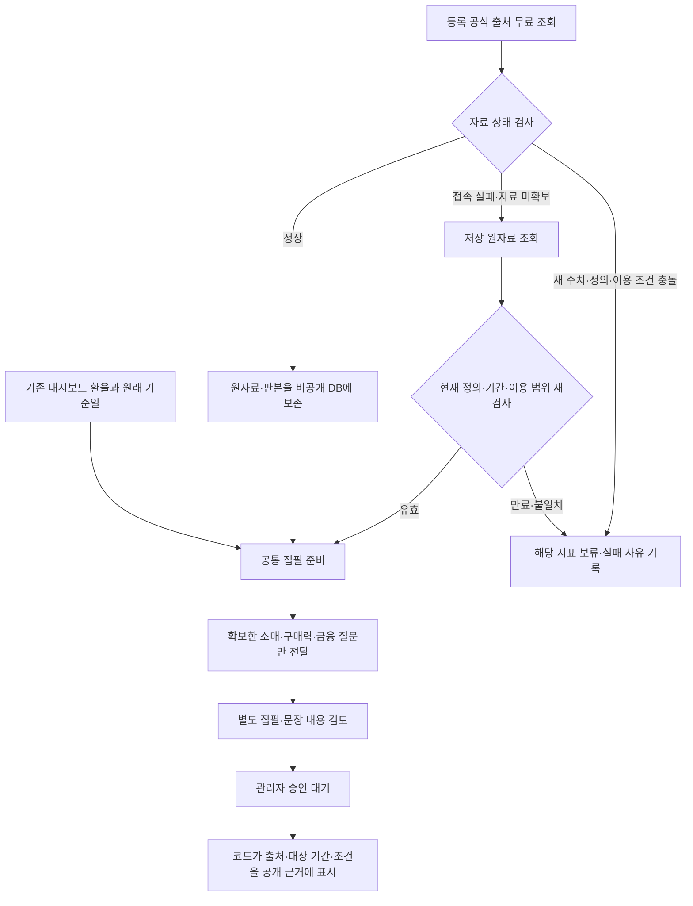

# 공식 자료 연결 1~3단계 마감 — 2026-11-01

> 후속 상태: [4단계 정정 후보 연결](report-correction-connection-20261101.md)을 추가했다. 아래는 1~3단계 마감 시점의 보존 기록이다.

## 범위와 결론

사용자 요청인 **1단계 마감과 2~3단계 연결**을 로컬에서 완료했다. 아래 단계 번호는 남은 작업을 중복 없이 합친 7단계 계획의 번호다. 과거 문서의 다른 1~3번 작업 번호와 구분한다.

| 단계 | 이번 연결 | 상태 |
|---|---|---|
| 1. 공식 자료·집필 입력 | 6개 통화의 등록 지표 정의·대상 월·발표/확보 시점·수정/이용 범위 검사, 지원하는 질문만 집필 입력에 전달 | 로컬 완료 |
| 2. 자동 실행 환경·원자료 재사용 | 공통 운영 진입점에 서비스 전용 DB 캐시 연결. 매번 현재 정의·기간·이용 범위를 재검사. Actions에 INEGI 토큰 참조·고정 PDF 의존성 추가 | 로컬 완료. Actions 실제 실행·운영 secret 존재 확인은 미실시 |
| 3. 공개 출처·기간·계산·이용 조건 | 코드가 기존 근거 요약과 인쇄 출처에 고지 전달. 모델 입력의 중복 고지 제거. 승인·공개 투영에서 고지 보존 확인 | 로컬 완료. 실제 내용 검토·게시 승인은 별도 |

실제 모델 호출 0, 신규 유료 비용 $0, 운영 변경 0. 기존 환율·원고·공개 결과·예산/활성화 설정을 보존했다. 새 캐시 migration은 `latamfx-2x-isolated` 로컬 DB에만 적용했다. 새 AI 리포트나 실제 원고 품질 합격을 뜻하지 않는다.

## 공통 흐름

과거 월 통계는 소비·금융 환경 자료다. 당일 환율 원인을 대신하지 않는다. 등록 지표 한 개의 통과를 국가 전체 소비 환경의 확인으로 확대하지 않는다. 지표 정의·질문 분류·검사 경로는 공통이고 기관·단위·가격·달력·지표 정의만 등록 자료에 따른다.

## 실제 무료 조회와 국가별 상태

공통 수집에서 실제 무료 공식 요청 16회, PEN의 공식 문서·JSON·CSV·목록 대체 경로 확인 4회를 수행했다. 합계 20회이며 유료 검색·모델 요청은 없다.

| 통화 | 전달 가능한 공식 수치 | 확인 결과 / 남은 제한 |
|---|---|---|
| BRL | IBGE 8월 실질 소매 전월비 +0.1%, 계절조정 | 새 API 응답 확인. 응답에 없는 발표일은 추정하지 않음 |
| MXN | INEGI 8월 실질 소매 지수 121.90334727·전년비 +3.3133%, 9월 물가 전월비 +0.42%·전년비 +3.45% | 실제 인증·조회·등록 발표자료 대조. 일부 조회 월 발표자료 미확보/추출 실패는 별도 상태로 보존. 전체 API 인증 실패로 처리하지 않음 |
| COP | DANE 8월 소매·차량 실질 매출 전년비 +7.3%, 잠정 | 33쪽 공식 PDF 추출·본문/표 대조. 발표일 10월16일 |
| PEN | BCRP 9월 현지통화 신용카드 금리 64.7713%, 유효 연율 **수준** | 신규 JSON·CSV·공식 목록이 HTTP200 차단 페이지. DB의 10월27일 확보 원자료를 현재 규칙으로 재검사해 자동 사용. 정책금리·국가 평균·상승률로 해석하지 않음 |
| CLP | INE 9월 IACM 실질 소매 활동 전년비 +4.4%, 잠정 | 새 공식 PDF 대조. 발표일 10월30일. 전체 IAC와 구분 |
| ARS | INDEC/정부 배포 8월 슈퍼마켓 실질 매출 전년비 −3.7420%, 원지수로 코드 계산 | 새 정의 API·CSV 대조. API 7월/CSV 8월 차이 보존. 발표일 추정 안 함 |

총 9개 수치다. 9개 보고서나 품질 평가 표본이 아니다. 소매·구매력·금융 중 아직 확보하지 못한 질문을 입력에 명시하고 다른 지표로 메우지 않는다. PEN 신규 수집 장애는 해결된 것으로 표시하지 않으며 저장 자료가 유효하지 않으면 해당 배경을 보류한다.

## 저장·재사용 경계

- `official-input-cache/1`의 고정 원자료와 결합 해시, 정의 버전, 원래 확보 시각을 저장한다. 재사용 시 오늘 시각으로 바꾸지 않는다.
- 매번 현재 지표·기간·이용 범위 검사에 다시 통과해야 한다. 새 응답의 정의/수치/이용 조건 충돌을 옛 정상 자료로 숨기지 않는다.
- `app_private.currency_report_official_inputs`는 service role만 읽고 추가한다. 익명·일반 사용자·관리자 브라우저에 원자료/RPC를 열지 않는다. 공개 원고 저장소와 분리한다.
- 중복 원자료는 최초 기록을 유지한다. ARS 정의 조회의 날짜 창 변화만으로 같은 본문을 중복 저장하지 않는다.
- 단일 기록 16MB·전체 논리 용량 50MB 상한이다. 초과 시 보류하며 자르거나 자동 삭제하지 않는다. 이전 제안의 보존 기간·정기 삭제를 이번에 활성화하지 않았다.
- PostgreSQL JSONB와 직렬화 원문을 중복 저장하지 않고 JSON text 한 벌로 보존한다. 기존 보존 원고는 변경하지 않는다.

## 공개 고지와 집필 입력

`official-publication.js`가 출처·대상 월·비교 방식·실질/명목·계절조정·잠정·발표일 유무·계산·등록된 이용 조건을 기존 공개 근거 요약에 넣는다. CLP의 CC BY-SA 4.0, ARS 배포의 CC BY 4.0처럼 확인된 조건만 표시하고 다른 출처에 같은 라이선스를 임의 적용하지 않는다. 원자료나 승인 내부 기록은 공개하지 않는다.

모델은 같은 고지를 반복 작성하지 않도록 짧은 통계 설명과 출처만 받는다. MXN 입력에서 중복 고지로 기존 44,000 입력 토큰 경계를 넘던 문제를 제거했다. 토큰 상한을 높이거나 내용을 임의 자르지 않았다. `delivered_by_code`는 등록된 수치 표시 조건의 충족이며, 문장의 근거 지지·내용 품질·관리자 게시 승인과 다르다. 명시적 금지·미등록 조건은 계속 보류한다.

## 자동 실행 환경

기존 `generate-data.yml`의 분리된 리포트 작업에만 `INEGI_INDICATORS_TOKEN` secret 참조, Python 3.12, `pypdf==6.10.0` 설치·버전 확인을 연결했다. 로컬 pypdf 버전도 6.10.0이다. 기존 환율·메일 작업, 기본 plan, 별도 execute 설정, 예산·목적지·보호 조건은 유지했다.

**GitHub의 실제 secret 등록 여부·Ubuntu Actions 실제 실행은 확인하지 않았다.** 이번에는 push·변수 변경·운영 활성화·실제 전송을 하지 않았다. 로컬에 새로 설치할 프로그램은 없다. 실제 실행 전 승인된 환경에서 secret 존재와 PDF 실행을 확인해야 한다.

## 검증 기록

| 검증 | 결과와 범위 |
|---|---|
| 정적·단위·전체 회귀 | 161파일, 1,184사례 통과. 타입·린트·테스트 감사·운영 빌드·번들 경계 통과 |
| 앱·리포트 빌드 | 두 빌드 통과. 기존 dbClient 정적/동적 import 혼용 경고는 남음 |
| 로컬 DB | 12개 pgTAP 파일·222검사 통과. 새 캐시 21검사 포함. 기존 RLS/권한/승인/복구 검사 포함 |
| 실제 원자료 DB 재사용 | 6통화 9수치. 별도 인스턴스가 수동 파일 주입 없이 재조회. 실제 저장 자료 + 합성 조회 장애를 구분 |
| 실제 무료 조회의 장애 처리 | PEN 실제 차단 후 DB 자동 재사용. MXN 일부 발표자료 실패와 정상 API 값 구분 |
| 공통 운영 진입점 | 기존24기사와 6통화 입력을 plan으로 재생. 6개 planned. 기능 비활성·예산 미설정 보류 유지. 모델0 |
| 승인·공개 고지 | 6개 합성 후보를 현재 버전 승인 RPC로 승인·익명 조회. 고지 보존·내부 필드 제외. 트랜잭션 전체 롤백, 실제 경제 원고 승인 아님 |
| 화면 | 기존 React A안에서 PC·390px 6통화, 근거 펼침·출처 링크·인쇄용 출처 DOM 확인. 가로 넘침 없음. 실제 인쇄창/종이 출력은 이번 미실시 |
| 비밀값 | 브라우저 산출물·확인용 자료108파일에서 실제 비밀값/비공개 기록 노출0. 키 값 출력0 |

시험 승인 코드는 기존 버전 RPC·공개본 식별자·새 시험 ID 계약을 사용했다. 과거 호출 형식과 중복 합성 ID 때문에 생긴 시험 설정 오류는 수정했고 제품의 보호 장치는 완화하지 않았다. 모든 실패 트랜잭션과 마지막 합격 트랜잭션은 되돌렸다.

확인 화면: [6통화 A안 표시 검사](http://127.0.0.1:4176/artifacts/stages123-20261101/index.html). **AI 미사용 표시 시험**으로 명시했다. 기존 AI 원고나 발행본으로 대체하지 않는다.

비공개 재현 기록: `.local-reports/private/stages123-20261101/`의 `final-inputs-result.json`, `live-result.json`, `pen-route-results.json`, `operation-plan-result.json`, `pgtap-result.json`, `public-notice-projection.log`, `mobile-ui-check.json`, `desktop-ui-check.json`, `privacy-check.json`. 공개 문서에 키·계정·원자료를 복사하지 않는다.

## 다음 고정 순서

| 순서 | 다음 작업 | 완료 판단 |
|---|---|---|
| 4 | 정정 후보 자동 연결 — Sol High | 새 자료와 기존 원고의 충돌을 문장·출처·이유로 기록. 공개 원고 자동 수정 금지 |
| 5 | 전체 흐름 독립 점검 — Astra High | 임시 국가 예외·중복·규칙 충돌·정상 자료 과잉 차단 검토 |
| 6 | 6통화 실제 자동 생성 시험 — Sol 실행/Astra 검토 | 입력·이용 범위·가격·예산을 재확인하고 승인된 호출 범위에서 무개입 시험. 실제 비용·보류·내용 품질 구분 |
| 7 | 파일럿·메일·전체 출시·복구 승인 | 실측 표본·운영 환경·별도 출시 승인. 이번 로컬 완료와 구분 |

PEN 신규 수집 장애, 일부 MXN 발표자료 미확보, 다른 소비 질문의 추가 지표, 실제 Actions 환경은 각각 현재 제한이다. 이미 연결한 공식 숫자의 로컬 검사와 실제 무인 운영 전체 합격을 합치지 않는다.
