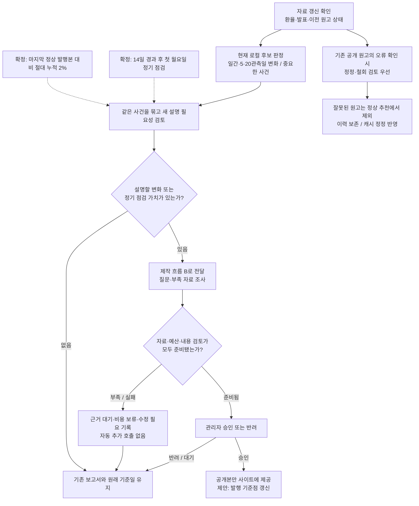
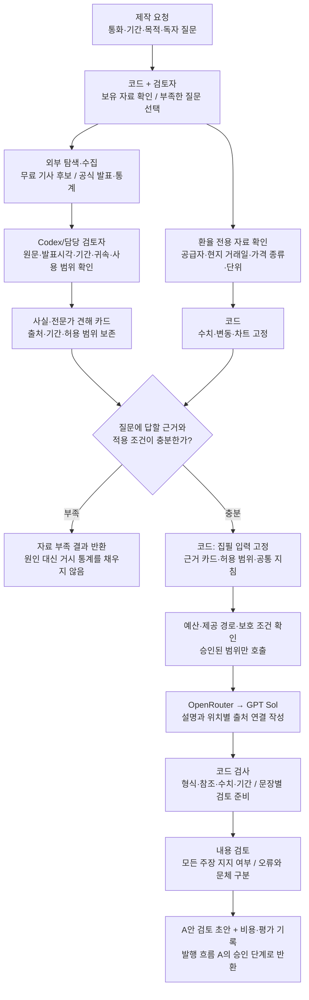

# LATAM FX 2.0 — 확정 기준·남은 작업·두 가지 흐름

기준일: 2026-10-27. 목적은 지금까지의 결정을 한곳에 모으는 것이다. **사용자 승인에 따라 문서상 발행 기준을 확정했다. 이후 정기 점검의 공통 생성·검토 경로를 로컬에서 추가했으며 운영 발행 설정은 변경하지 않았다.**

[두 흐름을 큰 도식으로 보기](report-service-flows-20261027.html)

현재 발행 기준: [발행 주기 상세 설계](publication-cadence-design-20261027.md). **CLP·MXN·BRL·COP 누적 2%와 한국 날짜 14일 경과 후 첫 월요일 정기 점검**을 사용자 승인으로 채택했다. 초기 3%는 과거 평가안이며 운영 적용은 보류한다.

콘텐츠 제안: [짧은 정기 점검 리포트 구성](periodic-report-content-20261027.md). 분량·배치·평가 방식은 검토할 제안이며 발행 기준 확정과 구분한다.

후속 로컬 구현: [정기 점검본 생성·검토 연결](periodic-check-generation-20261027.md). 검토된 근거에 따른 세 상태 선택·집필 범위·수치 조립·필수 검토를 연결했다. 저장 자료 재생을 확인했으며 새 AI 품질이나 운영 발행 자동화 완료를 뜻하지 않는다.

후속 검증: [발행 주기 오프라인 재생 결과](publication-cadence-replay-20261027.md). 실제 저장 수치와 가정한 발행 일정을 분리해 2%·3%·4%를 비교했다. 운영 발행 빈도·누락률의 검증 결과는 아니다.

추가 조사: [CLP·MXN·BRL·COP 누적 2% 재생](publication-cadence-four-currencies-2pct-20261027.md). 사용자 요청에 따라 2%로 네 통화를 비교했다. COP의 운영 지원 또는 기존 발행 설정을 변경한 것은 아니다.

## 1. 지금 어디까지 왔는가

**확인한 자료로 AI 원고를 만들고 A안에서 비교하는 로컬 제작 경로가 있다. 매일 자료를 찾아 판단하고 승인본을 운영 사이트에 제공하는 전체 서비스는 아직 완성되지 않았다.** 현재는 수집·계산·검사 도구 사이에서 Codex가 자료 채택과 문장 검토를 이어 주는 반자동 과정이다.

다음 표에서 ‘확정’은 사용자의 결정이나 합의된 기준, ‘구현’은 코드가 있는 범위, ‘검증’은 실제로 확인한 범위를 뜻한다. 서로 같은 의미가 아니다.

| 항목 | 확정된 방향 | 현재 확인 상태 / 남은 부분 |
| --- | --- | --- |
| 독자·목적 | 영업·손익·가격 관리 담당자가 환율 변화와 소비·판매 환경을 이해하도록 돕는다 | 회사별 매출·마진·재고를 추정하거나 가격·판촉 업무를 지시하지 않는다 |
| 기본 집필 모델 | **GPT Sol을 기본으로 선택**. 향후 성능에 따라 Claude·Gemini로 교체할 수 있게 준비 | `openai/gpt-6.1-sol` 실제 비교 완료. 모든 공통 경로의 기본 설정 전환은 미완료 |
| 화면 | 통화별 한 장, **A안**. PC·모바일·인쇄를 고려 | 로컬 화면·기존 앱 연결 시험 기록 있음. 전체 2.0 UI 재설계 완료는 아님 |
| 대상 통화 | **CLP·MXN·BRL·COP** | 최근 검증은 CLP 중심. COP의 누적 일정 재생은 했으나 기존 단기 판정·자료 연결 검증은 남음 |
| 발행 원칙 | **마지막 정상 환율 점검본 대비 절대 누적 2% 또는 14일 경과 후 첫 월요일 정기 점검**. 급변·중요 사건 경로 유지 | 기준은 확정, 운영 연결은 미완료. 근거·내용 검토·관리자 승인 없이 자동 발행하지 않음 |
| 자료 역할 | 환율 원인은 시장 기사·확인된 사건으로, 소비 배경은 적합한 공식 통계로 설명 | 월간 통계를 당일 환율 원인의 대체 근거로 쓰지 않는다 |
| 초기 게시 | 내용 검토 후 관리자 승인 | 자동 검사가 통과해도 자동 게시하지 않는다. 승인·권한의 로컬 시험과 운영 연결 완료를 구분 |
| 변경 경계 | 기존 원고·근거·비용·승인 기록 보존 | 이번 작업은 문서만. 유료 호출·앱 구현·운영·DB·배포·메일 변경 없음 |

확인 기준은 현재 작업 폴더의 코드와 저장 기록이다. 브랜치는 `codex/2.0-local-experience`, HEAD는 `b08305e`이며 **미커밋 변경이 많아 이 SHA만으로 현재 작업 전체를 재현할 수는 없다.** 실제 운영 배포 버전은 이번에 조회하지 않았다.

## 2. 모델 결정과 교체 기준

Sol을 기본 집필자로 선택하되, 자료 수집·수치 계산·품질 기준·게시 승인은 모델과 분리한다. 교체할 때 바꿀 것은 집필 모델과 그 모델이 지원하는 요청 형식·제공 경로다. 근거 기준이나 합격 기준을 모델에 맞춰 낮추지 않는다.

최근 동일한 2026-09-10 CLP 입력의 실측은 다음과 같다. **이번 한 사례의 비교이며 가격표·일반 성능 순위가 아니다.** 평가는 같은 에이전트의 잠정 평가로 독립 맹검이 아니다.

| 집필 모델 | 실제 비용 | 잠정 평균 | 판단 |
| --- | ---: | ---: | --- |
| Claude Sonnet 5.5 | $0.045854 | 3.5/5 | 원문 보존, 검토 대기 |
| GPT Sol | $0.0405485 | 3.6/5 | 기본 모델로 선택. 품질 4.0 합격을 의미하지 않음 |
| Gemini 4 Argon | $0.0354508 | 3.4/5 | Reuters 귀속 범위 교정 항목 포함, 검토 대기 |

세 원고 모두 입력에 영업 환경 근거가 부족했고 평균 4.0에 도달하지 못했다. 모델 교체만으로 자료 부족이 해결되는 것은 아니다. [실제 원문·비용 비교](../../artifacts/clp-three-model-comparison-20261027.html)

**준비할 구현:** 한곳에서 집필 모델을 지정하고, 제공 경로·출력 형식·가격·개인정보 보호 조건을 사전 확인하며, 실행마다 실제 모델·지침 버전·비용을 기록한다. 기존 `lifecycle-control.js`에는 Sonnet 설정이 남아 있다. 세 모델 비교 경로가 있다는 사실을 범용 교체 기능 완성으로 해석하지 않는다.

**향후 교체 절차 제안:** 같은 고정 사례로 비교 → 필수 오류·설명력·비용·실패율 검토 → 사용자 결정 → 새 버전부터 적용. 장애 때 임의로 다른 모델을 호출하는 자동 백업은 별도 승인 없이 켜지 않는다. 이번 문서로 신규 호출 예산은 생기지 않는다.

## 3. 발행 주기 — 현재 구현과 확정 기준

### 현재 로컬 판정기가 하는 일

아래는 **조사 후보를 찾는 코드 설정**이다. 검증된 운영 발행 임계값이 아니다.

| 비교 구간 | 현재 조사 기준 | 주의점 |
| --- | --- | --- |
| 전 관측일 | 절대 변화 ≥ max(0.75%, 과거 P80) | 급변 우선순위는 max(1.5%, 과거 P95) |
| 5관측일 | 절대 변화 ≥ max(2%, 과거 P80) | 5일 누적 변화도 포착 |
| 20관측일 | 절대 변화 ≥ max(4%, 과거 P80) | 완만한 중기 변화도 포착 |

P80·P95는 현재 관측을 제외한 직전 60개의 같은 구간 변화에서 계산한 백분위다. 표본 부족·보간·결측·가격 기준 충돌은 정상 변화 없음과 구분한다. 상승과 하락 모두 절대 크기로 후보를 찾고 방향을 따로 보존한다.

정책·물가·소비 등 중요한 발표는 가격 변화와 독립된 후보 경로가 있다. 이전 후보·실패·검토 대기 기록과 겹치는지도 본다. 다만 **마지막 정상 발행본을 기준으로 누적 변화와 발행 간격을 판단하는 기능은 아직 없다.**

### 사용자 확정 기준 — 운영 적용 전

| 확정 기준 | 의도 | 남은 구현·검증 |
| --- | --- | --- |
| 마지막 정상 환율 점검본 대비 절대 누적 2% | 작은 변화가 계속돼도 새 조사 계기를 만든다 | 동일 공급자·가격 종류·단위 확인, COP 연결, 실제 사건·중복 검증 |
| 14일 경과 후 첫 월요일 정기 점검 | 조용한 시장에서도 현재 상태를 설명할 기회를 만든다 | 한국 날짜 기준. 국가별 공표·휴장 자료와 검토 시각·담당자 확인 |
| 같은 날 여러 계기는 하나로 묶기 | 일간·누적·발표·정기 조건이 겹쳐도 반복 집필을 막는다 | 사건별 새 사실과 기존 설명의 변화를 보존 |
| 자료 부족이면 발행 대기 | 날짜 조건을 채우려고 원인이나 소비 의미를 만들지 않는다 | 점검 완료·발행 보류 사유를 표시하는 방식 결정 |

예를 들어 1달러당 현지통화 값이 매일 0.3%씩 10관측일 상승하면 누적 변화는 `((1.003)^10 − 1) × 100 ≈ 3.04%`다. 일간 기준만으로 놓칠 수 있다. 기존 5·20관측일 기준이 일부를 포착하더라도 마지막 보고서를 읽은 시점과는 다른 비교이므로 발행본 기준을 보완할 가치가 있다.

누적 계산은 같은 통화·공급자·가격 종류·단위의 **발행 당시 고정 관측값**과 비교하는 안을 권장한다. `현재값 / 발행본의 관측값 − 1`을 사용하며, 1달러당 현지통화 값의 상승은 현지통화 약세 방향이다. 환율 역수의 강약 비율과 혼용하지 않는다.

기준점은 새 정상 보고서가 실제 게시됐을 때만 갱신하는 안이다. 생성 실패·반려·검토 대기·제목 수정은 기준점을 재설정하지 않는다. 정정·철회된 원고, 첫 보고서 없음, 가격 공급자 변경 때의 기준점 선택은 상세 설계가 남아 있다.

정기 보고서는 ‘마지막 보고서 이후 달라진 수치 / 유지·변경된 설명 / 다음 주요 일정’을 짧게 정리할 수 있다. **정기 작성 계기가 왔다는 이유로 원인 근거나 검토를 면제하지 않는다.** 월요일 가격은 최신 완료된 현지 거래 자료를 사용하고 실제 거래일을 표시하는 안이다. 일정 도래와 발행 보장은 다르다.

## 4. 다이어그램 A — 언제 조사하고 언제 발행하는가

이 도식은 **현재 요소와 확정 기준을 합친 목표 판단 흐름**이다. 실선은 절차, 점선은 운영 미연결 기준의 입력을 뜻하며, 실선이라고 운영 자동화가 끝났다는 뜻은 아니다.

현재 로컬 후보 판정은 구현되어 있다. 새 후보를 조사·집필·관리자 승인·운영 공개까지 자동으로 이어 주는 통합, 제안된 기준점 관리와 정정·캐시의 운영 보장은 미완료다. 이메일 보강과 자동 게시는 이 도식의 기본 공개 경로에 포함하지 않으며 별도 승인 대상이다.

## 5. 다이어그램 B — 자료를 어디서 가져와 누가 만드는가

**외부 검색은 집필보다 앞에 있는 별도 단계다. Sol에게 원고 작성을 요청하는 것만으로 인터넷 검색이 실행되지는 않는다.** 현재는 기존 탐색 도구와 Codex의 원문 검토가 함께 수행된다.

위 ‘사실·견해 카드’에는 짧게 정리한 사실, 발언자의 견해, 출처와 URL, 발표·대상 기간, 허용 주장과 조건이 들어간다. 원문을 통째로 집필 모델에 보내는 경로가 아니다. 코드 검사가 실패하거나 내용상 중대한 오류가 있으면 수정 필요·보류 결과로 돌아가며 자동 재작성하지 않는다.

| 자료 경로 | 역할과 현재 범위 |
| --- | --- |
| BCCh 칠레 중앙은행 환율 | CLP 공식 시리즈의 거래일·고시일·가격 종류 확인과 로컬 연결 시험. 거래 가중평균과 기사 마감 호가를 같은 값으로 쓰지 않음. 다른 통화 검증·공개 서비스 이용 범위는 별도 |
| DF·Pulso·Emol·Yahoo의 시장 기사 | 9월 10일 CLP 사실·전문가 견해 카드로 실제 시험. Yahoo에 실린 Reuters 저자 해설은 저자 견해와 시점을 보존. 네 매체의 지속 자동 수집·공개 재사용이 모두 허용됐다고 간주하지 않음 |
| 기존 뉴스 탐색 도구 | GDELT·사이트맵·Alpha Vantage 등 기존 후보 탐색 경로. 모든 경로가 매 요청마다 실행되는 것은 아니며 탐색 결과만으로 근거 채택하지 않음. 유료 뉴스 도입은 범위 밖 |
| INE 등 공식 통계·경제 발표 | 소비·실질 보수·정책의 배경. 예: 8월 통계는 발표일이 10월이어도 8월 지표이며 10월 환율 급변의 원인을 대신 설명하지 않음 |
| 경제 일정 | 조사할 시점을 알려 주는 자료. 예정 일정·실제 발표·수치 확인·근거 채택은 별개. 국가별 자동 연결 범위가 다름 |

현재 의미 판단을 하는 Codex는 운영 서비스에 자동 포함되는 부품이 아니다. 자동화를 위해서는 자료 채택·신규성·문장 근거 검토의 책임과 실행 경로, 필요시 검토 모델의 비용·평가를 따로 정해야 한다. 그 준비 전에는 담당 검토자의 확인이 남는다.

## 6. 유지할 공통 품질 기준

1. 새 정보 → 시장 반응 경로 → 확인 가능한 통화 연결을 설명한다. 글로벌 달러 강세를 근거 없는 현지 달러 수요 증가로 바꾸지 않는다.
2. 사실·특정 전문가 해석·승인된 일반 원리를 구분한다. 한 사람의 중요도 평가를 시장 전체의 요인 순위로 넓히지 않는다.
3. 제목·요약·소제목에도 본문과 같은 근거 기준을 적용한다. 출처 ID가 있다는 사실만으로 그 문장의 모든 주장이 입증되는 것은 아니다.
4. 본문은 설명에 집중한다. 기여도 미산출 같은 반복 안내는 공통 한계에 한 번 두되, 해석을 바꾸는 실제 조건·반대 근거는 해당 위치에 남긴다.
5. 수치·관측 기준·기간·출처 표시는 코드가 담당한다. 사후 해설을 선행 원인으로 쓰지 않는다. 최소 글자 수나 항목 개수 채우기로 품질을 평가하지 않는다.
6. 영업 관련 설명은 구매력·수입 환산·금융 여건·소비 흐름 중 근거가 있는 범위만 쓴다. 자료가 없으면 관련성이 부족하다고 기록한다.
7. 필수 오류와 문체 개선을 구분한다. **자료 상태 / 집필 자격 / 내용 품질 / 게시 승인**을 하나의 통과 값으로 합치지 않는다.

현재 합격 목표는 원인 설명·변화 전달·영업 관련성·가독성·근거 충실도 평균 4/5 이상, 근거 충실도 4/5 이상, 필수 내용 검토 통과, 중대한 오류 0건이다. 사용자 독자 평가와 에이전트 잠정 평가를 별도로 남긴다. 이 목표를 자동 검사 수나 작은 점수 차이로 대체하지 않는다.

## 7. 남은 작업 — 실행 순서와 완료 증거

| 순서 | 작업 | 완료를 판단할 증거 | 권장 개발 모델 |
| --- | --- | --- | --- |
| 1 | 확정 발행 기준과 정기 점검본 내용 검토 | 네 통화·누적 2%·정기 간격은 확정. 짧은 점검본 구성·독자 평가와 세부 예외 검토가 남음 | Astra High |
| 2 | 무비용 판정 재생 보강 | 네 통화 2% 저장 수치 재생 완료. 공식 가격·휴장·실제 중요 사건의 누락 검증은 남음 | Sol High, 판단 검토 Astra High |
| 3 | Sol 기본 설정과 교체 구조 연결 | 공통 설정, 모델별 형식·제공 경로 검사, 실행 버전 기록, 무단 백업·추가 호출 차단 | Sol High |
| 4 | 자료 조사·채택·내용 검토 연결 | 뉴스의 지속 사용 범위, 가격 기준, 국가별 수집 상태, 반복 조사 방법, 자동과 사람의 담당 경계 | Astra High + Sol High |
| 5 | 실제 생성 품질 확인 | 별도 승인 예산으로 고정 사례 평가. 수동 편집 성공과 자동 생성 성공을 분리 | Astra High 검토, Sol 집필 |
| 6 | 승인·공개 연결과 UI 2.0 정리 | 최신 코드로 권한·장애·캐시·정정 검증, 탭 통합과 리포트 진입의 사용자 검토 | Sol High |
| 7 | 파일럿·출시·복구 판단 | 운영 관찰 표본, 지원 통화·예산·담당자 결정, 프리뷰·복구 시험, 별도 출시 승인 | Astra High 판단 + Sol High 반영 |

로컬 승인·권한·조회 장애 시험 기록은 존재한다. [10월 16일 검증](local-release-verification-20261016.json)은 당시 로컬 DB·모의 승인 등을 포함하며 최신 코드 전체의 운영 합격 증거로 승격하지 않는다. 당시 기록에도 운영 제공 경로 연결과 CLI 기반 새 DB 재구축 검증이 남아 있다.

기존 파일럿 계획은 최소 10영업일 관찰과 평가 초안 10건, 표본 부족 시 최대 20영업일까지 연장이다. 발행을 강제하지 않는다. 승인율 90%·평균 4/5·중대한 오류 및 개인정보 노출 0건을 목표로 하되, 새 발행 주기로 표본 확보가 가능한지도 다시 검토한다. 관찰 기간을 실제로 수행하지 않고 완료로 표시하지 않는다.

리포트 작성 기능 완성, 리포트 포함 UI 2.0 검토, 기존 메뉴 단순화는 별도 작업이다. 계획 대비·관리 탭 통합은 사용자 제안 사례이며 최종 화면 구조로 확정되지 않았다. 자동 게시·이메일 보강·운영 반영은 각각 별도 결정한다.

## 8. 문서 우선순위와 과거 기록

이 문서는 **2026-10-27 현재 결정과 미완료 상태의 입구**다. 세부 구현 근거는 아래에 연결하고 과거 기록을 덮어쓰지 않는다. 더 나중에 승인된 결정이 생기면 기준 문서를 갱신한다.

| 기록 | 읽는 방법 |
| --- | --- |
| [공통 생성·검토 기준](common-report-rules.md) | 맨 위 현재 버전: input/10, writer-links/1, reasoning/4, editorial/9, rules/7, claim-review/7. 날짜별 과거 지침을 합산하지 않음 |
| [기존 생성 판정 설계](generation-decision-plan.md) / [실제 판정 코드](../../scripts/currency-report/generation-decision.js) | 이전 설계에는 ‘발행 후 누적을 독립 기준으로 두지 않음’이 있음. 현재 새 누적 제안과의 변경 검토 대상이며, 이미 변경된 코드로 해석하지 않음 |
| [10월 16일 제작 설명](report-creation-flow-20261016.md) | 당시 소비 통계·Sonnet 중심 사례 설명. 현재 기본 모델 결정과 최신 뉴스 카드 시험은 이 문서를 함께 읽음 |
| [환율 원인 경로 기록](fx-cause-workflow-20261027.md) | 특정 자료의 사용 범위 보류 기록. 같은 날 이후의 별도 사실·견해 카드 시험까지 전부 실패했다는 뜻은 아님 |
| [출처 경로 검토](report-source-routes-20261027.json) / [사실·견해 카드 기준](news-notes-input-20261027.md) | 출처 등록·자동 수집·근거 채택·AI 입력·공개 이용을 구분 |
| [누적 실행 기록](execution-status.md) / [출시 백로그](release-backlog.md) | 과거 완료·보류·비용·승인 기록 보존. 당시 ‘다음’ 항목을 현재 할 일로 그대로 합산하지 않음 |

이번 문서 작성은 저장된 코드·기록의 대조이며 새 기사·가격·약관 조회, AI 호출, 테스트 재실행, 운영 상태 확인을 수행한 결과가 아니다. 비교 캠페인의 과거 확정 비용 $0.4411813과 미확인 예약 $0.248248은 별도 기록으로 유지하며, 이번 추가 비용은 $0이다.
