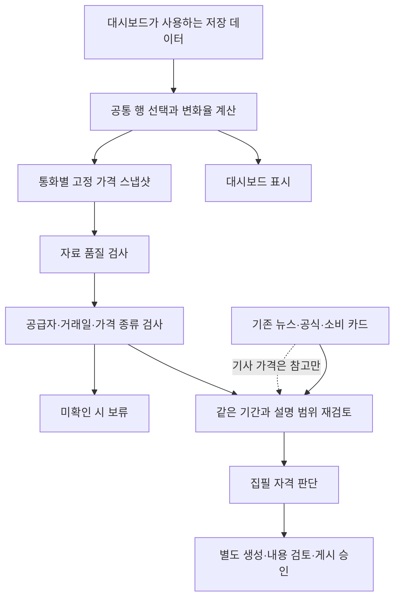

# 대시보드·리포트 공통 가격 및 준비 기준

2026-10-28 · 사용자 방향 변경 반영 · 로컬 구현/저장 자료 검증 · 운영 반영 없음

**최신 가격 정책:** [기준환율 정책](reference-rate-policy-20261028.md)의 `shared-dashboard-report/3`을 우선한다. 사용자가 현재 API 환율을 회사 기준환율과 같다고 가정하도록 승인했다. 실제 동일성은 사용자 확인 대기다. 종가는 선택적 보조 자료이며, 아래 최초 구현의 현지 종가/거래일 일괄 보류는 과거 판정으로 보존한다. 가격 품질·근거의 기간/범위·출처 이용·게시 승인은 계속 별도로 확인한다.

## 확정 기준

**새 리포트의 대표 환율·비교값·차트는 대시보드와 같은 저장 데이터에서 가져온다.**
기사에서 환율을 찾지 못해도 이 가격 경로는 작동한다. 기사 수치는 해당 기사의 관측 시점과 가격 종류를 설명하는 참고 자료이며, 대표 환율이나 발행 기준값을 대신하지 않는다.

이 문서는 이전의 ‘검증된 별도 시장 가격을 리포트에 사용’ 방침을 새 준비 경로에서 대체한다. 이전 원고·공식 가격 대조·기사 가격 검토·비용 기록은 당시 기준의 이력으로 보존한다. 과거 평가를 취소하거나 새 기준의 승인으로 재해석하지 않는다.

현재 공통 버전: `shared-dashboard-report/2`. 6개 통화 준비 경로: `six-currency-preparation/2`. 같은 날 최초 `/1`의 결과는 보존한다. [수집 기록 후속 구현·실제/합성 검증·남은 전달 범위](price-provenance-hardening-20261028.md)를 함께 적용한다.

| 공통 필수 항목 | 모든 통화에 적용하는 기준 |
| --- | --- |
| 숫자 | 대시보드와 같은 행 선택·계산 사용. 마지막 원고 발행 시 선택한 스냅샷은 고정 |
| 단위·방향 | 현지통화/USD. 값 상승은 현지통화 약세. 퍼센트와 소수 비율 구분 |
| 자료 품질 | 결측·0·중복·보간·오래된 자료를 변화 없음 또는 정상 실측으로 처리하지 않음 |
| 가격 성격·시점 | 공급자 갱신일, 수집시각, 현지 거래일, 가격 종류를 분리. API라는 표시는 종가 증거가 아님 |
| 기사 연결 | 기사의 거래일·가격 종류·설명 범위를 대조. 다른 가격의 상승/하락 설명을 대표 가격의 원인으로 이식하지 않음 |
| 주장 검토 | 사실·귀속 견해·일반 원리를 구분. 문장의 모든 주장을 근거가 지지해야 함 |
| 출처 이용 | 등록된 경로와 실제 자료의 사용·표시 조건을 확인. 수집 성공만으로 모델 입력/게시 승인하지 않음 |
| 소비 배경 | 발표일과 지표 대상 기간·단위·계절조정·수정 여부 유지. 월간 통계를 당일 환율 원인으로 사용하지 않음 |
| 상태 | 자료 상태·집필 자격·내용 품질·게시 승인을 별도로 기록 |
| 실패 | 기사 가격으로 대체하지 않고 영향받는 설명/집필을 보류. 기존 보고서의 날짜·본문 보존 |

## 국가별 차이는 명시적인 자료 정의로 관리

`COUNTRY_REPORT_PROFILES`는 통화·현지 시간대·단위·기존 국가별 출처 등록부·지표 정의 요구사항을 연결한다. 새 국가 전용 합격 검사나 조건 완화를 추가하지 않는다. 시간대가 등록되어 있다는 사실은 휴일 캘린더나 종가 시간이 검증되었다는 뜻이 아니다.

| 통화 | 현지 시간대 | 기존 자료 재사용 시 구분할 정의 | 발행 정책 확정 여부 |
| --- | --- | --- | --- |
| BRL | America/Sao_Paulo | PTAX 조사 평균·현물 종가·장중 호가, IBGE 소매 업종 묶음 | 누적 ±2%, 14일 미발행 후 첫 월요일 점검 |
| MXN | America/Mexico_City | FIX·종가·결제일, INEGI 원계열/계절조정 | 위와 같음 |
| COP | America/Bogota | TRM 적용일·계산 대상 거래와 시장 종가 | 위와 같음 |
| PEN | America/Lima | 은행권 매수/매도·시장 가격, 개장 대비와 전일 대비 | 임계값·정기 주기 결정 대기 |
| CLP | America/Santiago | Dólar observado의 산정 대상과 게시일·현물 종가 | 누적 ±2%, 14일 미발행 후 첫 월요일 점검 |
| ARS | America/Argentina/Buenos_Aires | 공식 참조·도매·소매·금융환율, 같은 날짜라도 계열 구분 | 임계값·정기 주기 결정 대기 |

위 가격 정의는 **대조 시 혼용하면 안 되는 구분**이다. 국가별 대표 가격을 각각 이 자료로 교체한다는 뜻이 아니다. 누적 변화는 마지막 유효 발행본의 고정된 공통 가격 기준과 비교해야 한다. 과거 기사 가격 기준 원고에서 새 공통 기준으로 넘어갈 때는 자동으로 누적률을 계산하지 않는다. 최초 공통 기준 발행본 또는 검증된 기준 전환이 필요하다. 이번 작업은 발행 스케줄러를 운영에 연결하지 않는다.

## 현재 수집 경로 감사 결과

정적 코드 확인: `src/lib/api.ts`, `src/lib/merger.ts`, `src/lib/exchangeRateRepository.ts`, `src/types/exchangeRate.ts`.

1. Frankfurter 이력 뒤에 보충 이력·최신 자료가 합쳐진다. 코드는 Frankfurter **v1**을 사용한다. 최신 웹 문서의 v2 기능을 현재 코드의 동작으로 간주하지 않는다.
2. ExchangeRate-API 최신 응답은 해당 날짜의 전체 가격 묶음을 대입한다. 이후 Open ER가 보충 통화를, Currency API가 보충 통화와 KRW를 다시 대입할 수 있다. 따라서 모두 ‘주 공급자가 실패했을 때만 사용하는 폴백’은 아니다.
3. 보충 Alpha Vantage 이력은 주입 자료 뒤에 캐시를 합쳐 같은 통화 키의 캐시가 우선할 수 있다. 신구 비교 없이 합치는 문제를 후속 공통 수집 검증 항목으로 기록한다.
4. ExchangeRate-API/Open ER의 갱신시각은 UTC 날짜 문자열로 줄여 저장한다. 없으면 현재 UTC 날짜를 쓰는 경로도 있다. 현지 거래일로 검증한 날짜가 아니다.
5. Alpha Vantage에서 `4. close`를 읽지만 시리즈의 시간대·산정 기준은 최종 행에 보존하지 않는다. 이름이 close여도 모든 국가의 현지 종가임을 뜻하지 않는다.
6. 최종 행은 `API`, `NONE` 등의 상태만 저장한다. 실제 공급자·원응답·가격 종류·관측시각·현지 거래일 연결이 없다. 보간 여부는 별도 필드에 존재한다.
7. 기존 리포트 기본 계산은 주말/보간을 제외하는 반면 대시보드 당일 비교는 저장된 직전 숫자 행을 사용한다. 이번 공유 함수로 새 준비 경로의 숫자 선택을 통일했다. 보간을 표시용으로 보존하더라도 분석 자격은 별도로 보류한다.

공급자 자료도 ‘종가’ 단정의 근거로 과장하지 않는다. [ExchangeRate-API 표준 응답 문서](https://www.exchangerate-api.com/docs/standard-requests)는 환산율과 API 갱신시각을 설명한다. [Alpha Vantage FX_DAILY 문서](https://www.alphavantage.co/documentation/#fx-daily)는 일별 OHLC 자료를 설명한다. 이 정보만으로 현재 저장 행의 국가별 현지 종가 계보가 복원되지는 않는다. 기존 로컬 `price-basis.js` 조사도 Currency API 생성일과 거래일을 구분한다.

이는 **잘못된 환율을 확정한 결과가 아니다.** 공급자 교체나 날짜 이동으로 숫자를 고치기 전에 필요한 기록이 빠져 있음을 확인한 결과다. 수집 우선순위·날짜·값은 이번에 변경하지 않았다.

## 구현한 연결



- `src/lib/dashboard-price.js`: 기존 대시보드의 당일/직전 행 선택과 계산을 그대로 추출. 대시보드도 이를 호출한다.
- `shared-price-contract.js`: 6통화 같은 규칙·프로필·숫자·방향·해시·상태. 추가 비밀정보를 그대로 전달하지 않고 가격 필드만 투영한다.
- `six-currency-preparation.js`: 신규 준비 기본값은 공통 데이터 필수. 이전 입력은 자료 이력으로 재생하지만 새 스냅샷의 승인으로 승격하지 않는다. 이전 packet의 기사 가격·차트·사용한 호출 승인·요청 본문을 새 인계에 복사하지 않는다.
- `six-currency-preparation-local.js`: 명시적 비공개 JSON만 읽고 새 폴더에 결과를 저장한다. 환경변수·인증정보·외부 네트워크를 읽거나 호출하지 않는다.
- 구형 1단계 manifest는 `--historical-replay`를 명시해야 재생된다. 결과에 현재 정책 적격이 아님을 표시한다. 구형 시험 명령·원고 자체를 일괄 수정한 것은 아니다.

새 인계는 **가격 연결 및 검토 대기 자료**이다. 지금 가격의 출처/거래일 계약을 확인하지 못했으므로 실제 집필 요청은 `null`, 게시 승인도 없다. 검토가 끝나지 않은 연결을 ‘운영 집필 경로 완성’이라고 표시하지 않는다.

## 저장 자료 검증과 6통화 준비표

사용 자료: 앞서 10월 28일 06:19 UTC에 보존한 배포 사이트 정적 폴백. 기준일 10/28, 생성시각 05:45:30 UTC. 원래 다운로드 영수증의 SHA-256을 다시 확인했다. 같은 시점 저장한 원격 저장소 폴백과도 동일하다. **현재 Supabase 화면값이나 현재 배포를 새로 조회한 결과는 아니다.** 로컬 루트의 `public/data.json`/전체 이력은 9/12 자료이므로 최신값으로 바꾸거나 10/28로 재명명하지 않았다.

| 통화 | 저장 10/28 값 | 직전 저장 10/27 값 | 저장값 대비 변화 | 공통 숫자 연결 | 남은 설명자료 |
| --- | ---: | ---: | ---: | --- | --- |
| BRL | 5.3484 | 5.3474 | +0.018701% | 통과 | 기존 시장·소매 카드 보존, 새 가격의 기간과 재연결 |
| MXN | 18.6735 | 18.6368 | +0.196922% | 통과 | 기존 달러·시장·INEGI 카드 보존, 새 가격의 기간과 재연결 |
| COP | 3149.32853592 | 3138.78319917 | +0.335969% | 통과 | 기존 9/24 귀속 원인·외부 입력 이용 조건 검토는 최신 원인 승인과 별개 |
| PEN | 3.45142483 | 3.45100797 | +0.012079% | 통과 | 현지 원인 지지·기사 접근/이용 범위·통계 사용 범위 미완료 |
| CLP | 985.91438166 | 989.54312678 | −0.366709% | 통과 | 기존 시장·소비 카드 보존, 새 가격의 기간과 재연결 |
| ARS | 1538.21130951 | 1540.7217206 | −0.162937% | 통과 | 새 공통 가격이 어느 계열인지 확인 후 도매시장 설명과 연결 |

모두 **공급자·현지 거래일·가격 종류 미확인 → 직접 원인 집필 보류**다. 숫자 연결 통과는 종가 정확성이나 원고 품질 합격이 아니다. PEN에 새 기사 가격을 구해 넣는 과제와 COP/ARS 기사 종가를 대표값으로 맞추는 과제는 새 경로의 선행조건에서 제외한다. 남는 것은 뉴스 설명의 지지·사용 범위 및 공통 가격과의 기간 일치다.

재생 기록은 `.local-reports/private/shared-dashboard-contract-20261028-HIiDJf/`, 새 인계는 `.local-reports/private/six-currency-preparation-OHOPnp/`에 별도로 저장했다. 실제 저장 자료 재생과 합성 경계 테스트는 구분한다.

재현 명령(로컬, 외부 호출 없음):

```powershell
npm run report:prepare:six -- --input .local-reports/private/shared-dashboard-contract-20261028-HIiDJf/manifest.json
```

매번 새 결과 폴더를 만들며 원본을 수정하지 않는다. 과거 1버전 manifest는 별도 `--historical-replay`가 필요하다. 기본 실행에 데이터 파일이 없으면 기사 가격 경로로 내려가지 않고 중단한다.

검증 결과: 관련 14사례, 전체 **125파일·941실행 사례**, 타입 검사·린트·운영/로컬 앱/리포트 빌드와 번들 경계 통과. 추가한 8사례는 공통 숫자/방향·불변 스냅샷, 보간/주말, 중복/다른 단위, 결측, 0·품질 미확인, 오래된/미래 자료, 6국가 정책, 새 인계의 과거 승인 차단을 다룬다. 기존 파일 경계 시험에 명시적 과거 재생 검사를 추가했다. 테스트 이름·완전히 같은 본문·자기 비교 검사는 통과했으며 의미상 모든 중복이 없다는 보증은 아니다. 실제 AI 품질 표본은 늘지 않았다.

보호 대상으로 기록한 원고·환율·비용·저장 스냅샷 **93파일 변경/누락 0**. 저장 배포본과 저장 원격 저장소 폴백 동일, 6통화 현재/직전값·계산 동일, 9/12 로컬 전체/경량 파일의 해당 값 동일. 기존 500kB 빌드 경고는 남아 있고 진입 묶음은 610,410바이트다. 새 화면 디자인/실시간 운영 DB/국가별 종가 정확성은 이번 검증 범위에 포함하지 않았다.

## 다음 고정 작업 순서

1. **공통 수집 기록 보강 — Sol High:** 공급자별 가격 종류/갱신시각을 확인하고, 실제 선택한 값의 공급자·응답 연결·날짜 의미를 보존. 공급자 덮어쓰기·캐시 우선순위는 저장 응답 비교로 검증한 뒤 최소 변경. 최초에는 기존 수치와 함께 기록만 비교한다.
2. **기간·원인 연결 판단 — Astra High:** 새 기록으로 거래일/기준을 확인한 뒤 기존 6통화 카드의 범위를 다시 판정. exact tick이 없는 평균/참조 가격은 있는 정의대로 표시하며 종가로 바꾸지 않는다.
3. **통화별 남은 근거 마감 — Sol/Astra High:** COP·PEN 직접 원인/이용 공백, ARS 계열과 견해 범위 정리. 해결 안 된 국가는 이유를 기록하고 다음으로 이동. 가격은 공통 데이터를 유지한다.
4. **작성·품질 시험 및 출시 경로 복귀:** 별도 예산 승인 후 실제 생성, 승인/공개/UI 2.0, 파일럿·복구·출시 순서. 이번에 실행하지 않았다.

새 유료 호출·메일·운영 DB·정기 갱신·배포·원격 push 없음. 기존 원고·환율 파일 보존. 이번 연결로 실시간 완전 자동화나 운영 종가 정합성까지 완료된 것은 아니다.
