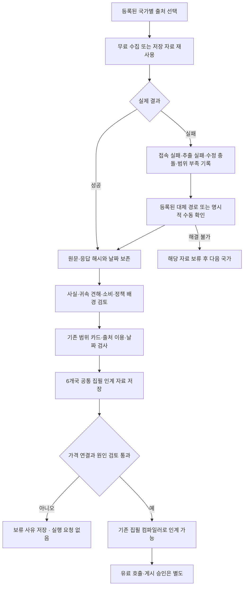

# 6개 통화 자료 준비 → 집필 입력 → 저장 검증

2026-10-28 · 4단계 국가별 자료 연결 결과 · 로컬 전용

후속: [BRL·COP·PEN·ARS 가격 기준 연결](four-currency-price-link-20261028.md)을 수행했다. 기사·공식 자료의 날짜/종류/숫자 대조는 공통 입력에 연결했으며, 동일 기준 전후 가격과 원인 집필 자격의 미확정 사항은 유지한다. 아래는 그 연결 전 자료 준비 단계의 기록이다.

## 이번 작업의 결론

BRL → COP → PEN → ARS 순서로 공개 자료를 확인하고, CLP·MXN 저장 입력을 재생했다. **6개 통화의 자료 인계 형식과 보류 사유 저장을 연결했다. 6개 통화의 자동 리포트 서비스가 완료된 것은 아니다.**

- CLP·MXN: 기존 검토 사례의 집필 준비 검사를 다시 통과했다. 새 원고·새 발행 승인이 아니다.
- BRL·COP·PEN·ARS: 사실·귀속 견해·공식 배경 카드를 저장하고 공통 입력 검사에 연결했다. 미해결 조건 때문에 실행 가능한 집필 요청은 만들지 않는다.
- 신규 유료 호출 0회, 신규 API 지출 $0. 원고·운영 환율·비용 장부를 보존한다. 운영·DB·배포·메일·정기 작업·원격 push는 수행하지 않는다.
- 새 API 토큰을 발급받을 필요는 확인되지 않았다. 이번 남은 문제는 토큰 부족보다 가격 기준 연결, 실제 설명 근거, 발표·이용 범위, 수집 장애다.

## 통화별 준비표

| 통화 | 이번에 확보·재사용한 자료 | 집필 입력 결과 | 남아 있는 핵심 조건 |
| --- | --- | --- | --- |
| **BRL** | Agência Brasil 10/26 현물시장 보도, InfoMoney 10/27 후속 해설·귀속 견해, BCB SGS 432, IBGE SIDRA 소매 6~8월 | 자료 인계 완료 / 집필 보류 | 현물 종가와 기존 공식 가격의 같은 거래일 연결; 소매 발표일·IBGE 이용 범위. SGS 적용일을 정책 발표일로 쓰지 않음 |
| **COP** | La República 10/26 시장 보도·국제 달러 해석, DANE EMC 8월 소매(10/16 발표), SFC 조회 결과 진단 | 자료 인계 완료 / 집필 보류 | COP 자체 움직임을 지지하는 귀속 해석 및 같은 가격 기준의 전후 거래일 연결. 기사 종가−당일 TRM을 전일비로 사용하지 않음 |
| **PEN** | Gestión·RPP 10/26 시황, INEI 8월 생산·상업 활동(10/15 발표), 기존 BCRP 금융 자료 | 자료 인계 완료 / 집필 보류 | PEN에 직접 연결되는 원인 근거, 오염된 공식 가격 API 응답 정상화 또는 검증된 대체 연결, INEI 외부 사용 범위 |
| **ARS** | Infobae 10/26 도매시장·브라질 파급 해석, BCRA 도매 참조값·기존 방법론, INDEC 8월 슈퍼마켓(10/22 발표) | 자료 인계 완료 / 집필 보류 | 도매 현물·BCRA 참조·소매·금융 환율 구분을 생성 경로에 연결. BCRA의 서비스 용도별 이용 범위와 INDEC 반복 수집 복구 |
| **CLP** | 기존 9/10 공식 가격·DF/Emol/Pulso/Yahoo 검토 카드·집필 입력 | **저장 사례 입력 준비 통과** | 이번 결과는 과거 사례 재생. 최신 거래일의 반복 조사·가격 연결·자료 채택을 별도로 확인해야 함 |
| **MXN** | 기존 10/26 공식 종가·시장 기사, Banxico 정책, INEGI 소매·물가 입력 | **저장 사례 입력 준비 통과** | 실제 새 원고 품질·반복 최신 수집·운영 승인은 미완료. FIX·공식 종가·기사 종가 구분 유지 |

새 4개국의 인계 자료는 **10/28 준비 기록에서 10/26 시장 사례를 검토한 것**이다. BRL 후속 기사는 10/27에 나온 자료다. 이를 10/26 당시 이미 확보한 입력이나 현재 새 발행본으로 표시하지 않는다. CLP의 9/10 사례와 MXN의 10/26 사례도 날짜를 합쳐 하나의 최신 시장 평가로 만들지 않는다.

## 수집 실패를 해결한 범위와 남긴 제한

이번에 실제 확인한 시장 기사: [브라질 Agência Brasil](https://agenciabrasil.ebc.com.br/economia/noticia/2026-10/dolar-sobe-821-e-bolsa-cai-1388-apos-reeleicao-de-lula), [브라질 InfoMoney 후속 해설](https://www.infomoney.com.br/mercados/dolar-apos-bater-os-r-540-com-reeleicao-de-lula-ate-onde-pode-ir/), [콜롬비아 La República](https://www.larepublica.co/finanzas/precios-del-dolar-y-el-petroleo-hoy-26-de-octubre-de-2026-4511039), [페루 Gestión](https://gestion.pe/economia/mercados/tipo-de-cambio-dolar-hoy-en-peru-cuanto-esta-el-precio-del-dolar-este-lunes-26-de-octubre-dolares-a-soles-compra-y-venta-bcrp-noticia/), [아르헨티나 Infobae](https://www.infobae.com/economia/2026/10/26/dolar-riesgo-pais-y-acciones-uno-por-uno-cuales-fueron-los-efectos-del-ballotage-de-brasil-en-el-mercado-financiero-argentino/). 링크는 채택한 주장 전체가 자동으로 입증됐다는 뜻이 아니다. 원문 위치·자체 카드·제외 범위는 비공개 검토 기록에 연결했다.

### 브라질

기존 IBGE API가 실패해도 해당 지표가 없다고 판단하지 않는다. 같은 공식 지표의 [SIDRA 대체 경로](https://apisidra.ibge.gov.br/values/t/8880/n1/all/v/11708/p/last%203/c11046/56734?formato=json)를 등록했다. 기존 수집 도구가 기본 경로 실패와 대체 경로 결과를 함께 기록한다. 변수 11708·분류 56734·전국·%·계절조정 정의를 확인하며, 다른 지역·변수·단위·중복 월은 거부한다.

8월 +0.1%는 **실질 소매 전체 판매량의 계절조정 전월비**다. 전년비·가전 판매·당일 환율 원인이 아니다. 응답에는 발표일이 없어 배경 카드도 집필 채택을 보류한다. IBGE 이용 안내는 403으로 확인하지 못했다. 이를 사용 금지 확정이나 허가 확인으로 바꾸지 않는다.

[BCB SGS 432 데이터셋](https://dadosabertos.bcb.gov.br/en/dataset/432-taxa-de-juros---meta-selic-definida-pelo-copom)의 ODbL 표시를 확인했다. 목표 Selic 계열 날짜는 정책 결정 발표 시각이 아니다. 응답에 포함된 미래 날짜는 현지 기준일 이후분을 제외해 저장했다. [PTAX 조회](https://ptax.bcb.gov.br/ptax_internet/consultarUltimaCotacaoDolar.do)의 평균 참조가격을 Agência Brasil의 현물 종가로 바꾸지 않는다.

Agência Brasil 본문 경계를 기존 추출기에 등록했다. 원문·번역은 모델에 보내지 않고 자체 문장으로 작성한 사실·귀속 견해만 인계한다. InfoMoney의 목표환율·매매 포지션과 무관한 과거 문단은 채택하지 않았다. 편집팀의 설명과 Wells Fargo 발언자의 조건부 평가를 구분한다.

### 콜롬비아

La República 본문 추출 실패를 등록된 본문 경계로 해결했다. 원문 종가가 3157.57, 당일 TRM이 3158.43이라는 비교를 보존한다. **두 값의 차이는 전일 대비 변화가 아니다.** 마감 내용이 있는 수정본은 18:59:32Z 기준으로 기록하고 최초 오전 게시 시각으로 소급하지 않는다.

미국 금리 차와 달러에 대한 Ray Attrill의 설명은 국제 배경으로 인계했다. COP의 직접 원인으로 승격하지 않았다. 원유 하락이 자동으로 COP 강세를 만든다는 단정도 추가하지 않았다.

[DANE 8월 EMC 원문](https://www.dane.gov.co/files/operaciones/EMC/bol-EMC-ago2026.pdf)과 [이용 조건 §2](https://www.dane.gov.co/index.php/terminos-y-condiciones)를 대조했다. 자체 정리한 수치·분석에는 지정 출처 표시 조건을 보존한다. 잠정 전국 소매 지표이며 개별 회사·TV 셀아웃이 아니다.

SFC 금융 데이터의 최신 제공일 조회는 7/31이었다. 10월 빈 응답은 해당 조회 범위의 부족이다. 확보한 7월 행도 기업 상업대출이므로 소비자 금융으로 쓰지 않는다.

### 페루

INEI의 오래된 PDF를 최신 자료라고 재사용하지 않고, 공식 gob.pe 목록에서 [10월 보고서 게시 페이지](https://www.gob.pe/institucion/inei/informes-publicaciones/8721470-informe-tecnico-produccion-nacional-n-10-octubre-2026)와 [8월 대상 원문](https://cdn.www.gob.pe/uploads/document/file/10796174/8721470-10-informe-tecnico-produccion-nacional-agosto-2026.pdf?v=1792076426)을 확인했다. 10/15 게시와 10/14 정보 마감은 별개다. 전체 생산·상업 활동 지표를 실질 소매 판매량으로 표시하지 않는다.

BCRP의 JSON과 단일 CSV 대체 조회 모두 데이터 뒤에 HTML 오류가 붙었다. 앞부분 수치가 기사와 같아도 **전체 응답을 오류로 제외**한다. 오류를 잘라내 정상 응답처럼 만들지 않는다. 이전 금융 자료는 별도 과거 배경이며 이번 환율 원인이나 정책금리가 아니다.

Gestión·RPP의 가격 보도는 확보했지만 국제 달러 관망 기사만으로 PEN 원인을 채우지 않았다. [BCRP 이용 안내](https://estadisticas.bcrp.gob.pe/estadisticas/series/ayuda/condiciones-de-uso)와 INEI 자료의 이용 범위도 서로 대체하지 않는다. INEI 외부 입력 범위는 보류 상태다.

### 아르헨티나

Infobae의 도매 현물 1541과 BCRA의 도매 참조 1540.4751은 다른 가격 종류다. 은행 소매·blue·MEP·CCL도 별도다. 같은 기사 내부의 전문가 호가가 조금 다른 부분도 하나의 정확한 숫자로 합치지 않았다. 브라질 헤알 경로에 대한 Cocos·Puente의 견해는 발언자에 귀속하며, BCRA의 새 공식 조치나 실제 판매 감소로 바꾸지 않는다.

Node 수집과 Windows 공개 요청에서 INDEC DNS 접속이 실패했다. 웹 도구로 [공식 슈퍼마켓 PDF](https://www.indec.gob.ar/uploads/informesdeprensa/super_10_268F0171F673.pdf)의 2~4쪽을 확인해 **수동 원문 검토**로 저장했다. 원본 바이트 수집 성공이나 원본 해시 확인으로 표시하지 않았다. 8월 실질 매출 전년비 -3.7%, 계절조정 전월비 -0.8%이며 전체 가계 소비·가전 판매로 확대하지 않는다.

[INDEC 공식 안내](https://www.indec.gob.ar/indec/web/Institucional-Indec-InformesTecnicos-47)의 CC 표시와 해당 PDF의 출처 표시 조건을 기록했다. 공개 구현의 출처·변경 표시 및 적용되는 동일조건 공유 범위는 출시 검토에 남긴다. [BCRA 이용 안내](https://www.bcra.gob.ar/aviso-legal/)의 용도별 조건은 별개이며 프로젝트의 공개 서비스 적용 범위를 임의 승인하지 않았다.

## 공통 연결 구조



새 `country-material-preparation.js`는 기존 범위 카드·뉴스 카드·출처 이용 검사·환율 원인 검사·Sol 기본 모델 정책을 재사용한다. 별도의 생성 엔진이나 자동 승인기를 만들지 않았다.

- 하나의 기사에서도 가격 사실·귀속 해석·국제 배경·반대 조건을 주장별로 분리한다.
- 소비·정책 자료의 대상 월과 발표일을 보존한다. 8월 통계가 10월 배경이 될 수 있지만 10월 환율 변동 원인은 아니다.
- 자료 확보, 내용 검토, 외부 모델 사용, 공개 표시, 가격·원인 자격, 게시 승인을 합치지 않는다.
- 집필 컴파일러가 패킷 전체를 받으므로 보류 자료가 포함돼 있으면 그대로 집필 준비 완료로 넘기지 않는다.
- 조회 실패는 실제 자료 부재가 아니다. 수동 확인은 자동 수집 성공이 아니다.
- 모든 결과는 `request=null`, `publicationDecision=null`, `paidCallAuthorized=false`다. 준비 통과도 유료 호출·게시 승인이 아니다.
- 출처 이용 기록은 범위를 한정한 검토자의 판단이다. 기사 전체를 자유롭게 재사용할 수 있다는 법률적 보증이나 매체의 포괄적 허가가 아니다.

## 로컬 결과물과 재현

비공개 입력·수집 원문·검토 기록은 Git 제외 경로 `.local-reports/private/six-currency-preparation-20261028/`에 있다. 외부 모델·웹 공개 번들에는 포함하지 않는다.

- `inputs/BRL.json` 등 6개: 같은 형식의 검토 입력. 이전 시도·준비 기록을 덮어쓰지 않고 최종 입력을 별도 저장했다.
- `verified-AeRrwP/summary.json`: 6개국 인계 저장 재생 결과.
- 같은 폴더 `BRL-collector-review.json`: 실제 SIDRA 응답을 기존 수집기 → 검토 카드로 연결한 결과. 발표일은 계속 미확인이다.
- 같은 폴더 `article-replays.json`: 실제 저장 브라질·콜롬비아 원문을 새 본문 어댑터로 재생한 결과.
- `ARS-manual-official-review.json`: 공식 PDF의 수동 확인 범위와 자동 수집 실패 기록.
- `MXN-existing-preparation-replay.json`, `CLP-writer-policy-replay.json`: 과거 승인·비용을 사용하지 않는 기존 입력의 재컴파일 기록.

재실행은 저장 입력을 지정한다. Node 런타임의 경로를 준비한 뒤 실행한다.

```powershell
node scripts/currency-report/country-material-preparation-local.mjs --input .local-reports/private/six-currency-preparation-20261028/inputs/BRL.json
```

통화별 새 비공개 결과 폴더가 생성되며 기존 결과는 덮어쓰지 않는다. 네트워크·환경 키 읽기·유료 호출·DB 쓰기는 없다. 위 경로의 원문 검토 기록은 로컬 자료이며 재실행이 의미 검토를 자동으로 다시 수행하지는 않는다.

## 원래 계획에 따라 다음에 할 일

현재 위치는 계속 **4단계 국가별 반복 조사·이용 범위·내용 검토 연결**이다. 통화별 미세 문체 수정이나 새 원고 제작으로 옆길로 가지 않는다.

1. **공통 가격·원인 연결 마감 — Sol High.** 새 환율 수집 서비스를 중복 구축하는 것이 아니라 기존 검증 자료를 BRL·COP·PEN·ARS의 기사 거래일·가격 종류와 연결한다. 관측되지 않은 전일값·시각을 역산해 채우지 않는다.
2. **국가별 남은 근거·사용 범위 — Astra High 판단, Sol High 연결.** BRL 발표일·IBGE, COP·PEN의 실제 원인, INEI 외부 입력 범위, ARS 반복 수집·BCRA 용도를 위 표대로 처리한다. 막힌 국가는 같은 이유를 반복 호출하지 않고 보류한다.
3. **5단계 실제 품질·비용 시험.** 준비 자격을 충족한 국가만 별도 예산 승인 후 Sol로 시험한다. CLP·MXN의 입력 통과를 네 통화의 품질 증거로 사용하지 않는다.
4. 이후 6단계 6개국 승인·공개·장애 및 UI 2.0, 7단계 파일럿·출시·복구 승인으로 진행한다. 기존 A안·환율 화면은 이번에 변경하지 않았다.

PEN·ARS의 발행 임계값은 이번에 임의 확정하지 않았다. CLP·MXN·BRL·COP의 누적 절대 2%와 2주 미발행 후 정기 점검 합의도 변경하지 않았다.

## 검증 상태

저장 원문 재생과 합성 경계 검사를 구분한다. 새 자동 검사는 기사 본문 경계, 공식 대체 경로, 잘못된 통계 정의·날짜, 출처 이용 보류, 수정본 시각, 글로벌 배경의 원인 승격 방지, 입력 변조, 비공개 저장·덮어쓰기 방지 등을 확인한다. 테스트 개수는 실제 원고 품질 표본 수가 아니다.

마감 결과:

| 검증 | 결과 |
| --- | --- |
| 실제 저장 입력 재생 | 6개 통화 인계 저장. CLP·MXN 기존 사례 통과, 나머지 4개국 보류 사유 재현 |
| 실제 저장 수집 응답 재생 | IBGE SIDRA → 기존 수집·범위 검토, Agência Brasil·La República 본문 어댑터 재생 통과 |
| 전체 자동 검사 | 111파일·799실행 사례 통과. 선언 644개 및 매개변수 확장 155개 |
| 정확 중복·자기 비교 감사 | 이름 중복·동일 정규화 본문·자기 자신 비교 0. 의미상 모든 중복이 없다는 증명은 아님 |
| 정적 검사 | typecheck·ESLint 통과 |
| 빌드 | 운영·기존 앱 로컬 리포트·A안 리포트 3종 및 번들 경계 검사 통과 |
| 기존 경고 | 기존 500kB 묶음 크기 경고 유지. 운영 진입 번들 610,348바이트 |
| 보존 대조 | 기준 파일 12,187개 중 의도한 소스·테스트·진행 문서 7개만 변경. 예상 밖 변경·삭제 0. 기존 원고·환율·비용 파일 불변 |
| 신규 비용·운영 | 신규 유료 모델 호출 0회·API 지출 $0·운영 변경 0 |

증거는 비공개 작업 폴더의 `unit-tests.json`, `test-inventory.json`, `preservation.json`과 저장 재생 폴더에 있다. 수집 과정의 무료 공개 GET은 자동 기록상 46회 시도·28개 응답 저장이며, 웹 도구 수동 확인은 이 자동 수집 수에 합산하지 않는다. 접속 장애와 대체 경로 시도도 원래 기록을 보존했다.

유료 품질 시험·독립 내용 재평가·최신 6개국 서비스의 운영 성공을 검증한 것은 아니다.
