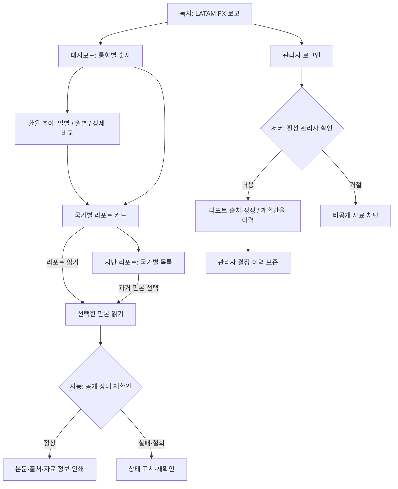
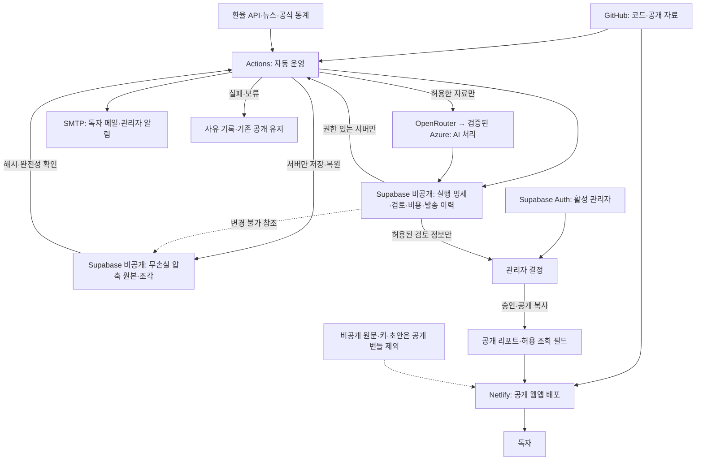
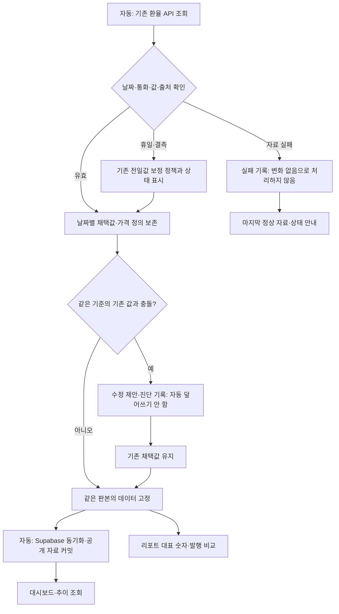
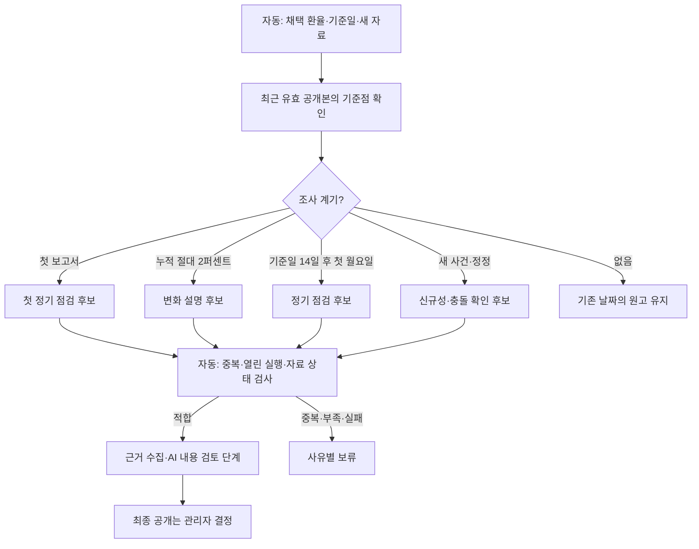
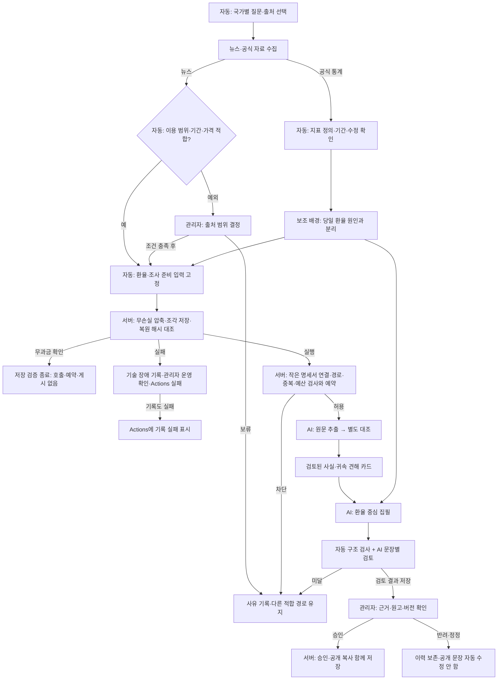
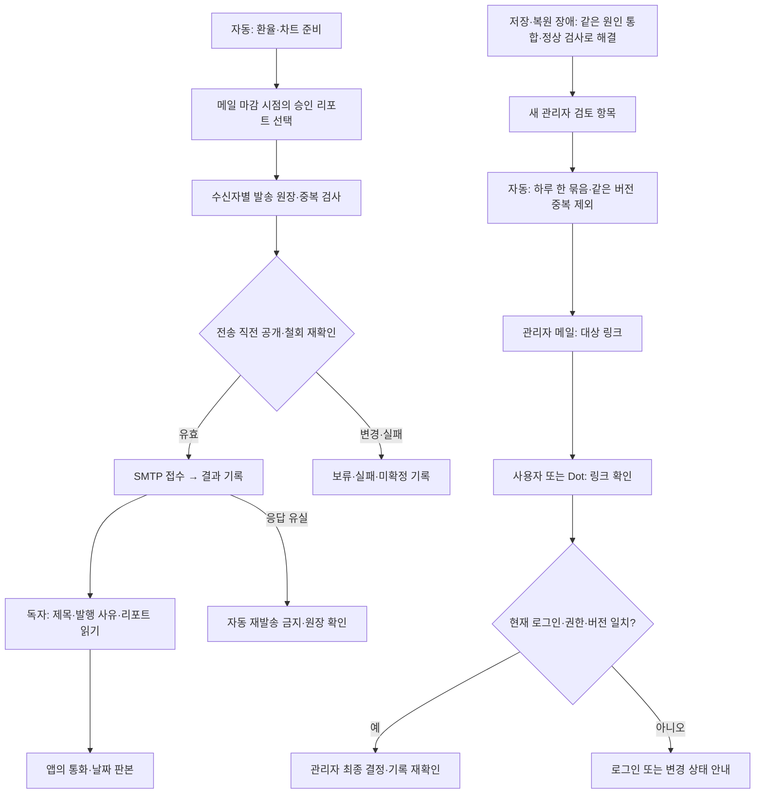

# 설계도·데이터 흐름

기준: 운영 배포 `681de0c` / 2026-11-10. 아래 여섯 도식은 현재 구현의 책임과 경계를 설명합니다. **운영 저장·복원 통과와 실제 AI 생성 성공은 다릅니다.** 확인 범위는 [운영 상태](operational-status.md)를 봅니다. 노드의 자동·AI·관리자 표기를 구분하며, 화살표는 권한·사용 범위·예산 검사를 생략하는 지름길이 아닙니다.

[여섯 도식 보기](diagrams/index.html)에서 확대해 볼 수 있습니다. 원본은 `.mmd`, 렌더링은 같은 이름의 `.svg`로 관리합니다. 원본 변경 시 두 결과를 함께 갱신합니다.
## 독자·관리자의 화면 이동

[Mermaid 원본](diagrams/01-navigation.mmd) · [확대 그림](diagrams/01-navigation.svg)

## 외부 서비스·저장소와 공개 경계

[Mermaid 원본](diagrams/02-services.mmd) · [확대 그림](diagrams/02-services.svg)

## 환율 수집·채택·동기화·조회

[Mermaid 원본](diagrams/03-rates.mmd) · [확대 그림](diagrams/03-rates.svg)

## 리포트 발행 필요성 판단

[Mermaid 원본](diagrams/04-cadence.mmd) · [확대 그림](diagrams/04-cadence.svg)

## 조사·카드·집필·검토·공개

[Mermaid 원본](diagrams/05-production.mmd) · [확대 그림](diagrams/05-production.svg)

## 독자 메일·관리자 알림과 앱 복귀

[Mermaid 원본](diagrams/06-email.mmd) · [확대 그림](diagrams/06-email.svg)

## 실제 진입점과 책임

위 도식에 분리 저장과 장애 알림 연결을 반영했습니다. 조각·해시·구형 `/1` 및 신형 `/2` 재개는 [저장·복원 상세 흐름](frozen-input-storage.md#저장과-재개-흐름)을 함께 봅니다. 원본 객체는 로그인 관리자도 직접 조회할 수 없으며 기존 검토 화면은 허용된 정보만 받습니다. AI·공개·비용 승인 경계는 바뀌지 않습니다.

| 흐름 | 구현 진입점 | 권한·실패 경계 |
| --- | --- | --- |
| 화면·선택·URL | [App](../../src/App.tsx), [리포트 목록](../../src/components/PublishedCurrencyReports.tsx) | 공개와 관리자 조회 구분 |
| 환율 생성·고정 | [generate-data](../../scripts/generate-data.ts), [채택 보관](../../scripts/dashboard-reference-archive.ts) | 관측·수집·보정 상태 보존 |
| DB 동기화 | [sync-fx-to-supabase](../../scripts/sync-fx-to-supabase.js) | 서비스 서버 경로, 공개 키와 분리 |
| 발행 판단 | [publication-cadence](../../scripts/currency-report/publication-cadence.js) | 후보와 발행 승인 분리 |
| 운영 조율 | [operating-entry](../../scripts/currency-report/operating-entry.js), [operating-cycle](../../scripts/currency-report/operating-cycle.js) | 설정·용량·예약·중복·국가별 상태 |
| 입력 보관·재개 | [operating-storage](../../scripts/currency-report/operating-storage.js), [추가 DB 변경](../../supabase/migrations/20261109150211_currency_operating_frozen_objects.sql) | 원본 무손실·서버 전용·조각 완전성·`/1`/`/2` 호환 |
| 무과금 저장 확인 | [전용 workflow](../../.github/workflows/report-storage-check.yml) | 모델 키·메일 인증정보 없음, 원본 저장은 수행 |
| 자료·원문 | [runtime-supply](../../scripts/currency-report/runtime-supply.js), [original-news-pipeline](../../scripts/currency-report/original-news-pipeline.js) | 이용 범위·판본·원문 대조 |
| 집필·검토 | [shared-writer](../../scripts/currency-report/shared-writer.js), [runtime-worker](../../scripts/currency-report/runtime-worker.js) | 모델 결과와 최종 게시 분리 |
| 관리자 승인 | [CurrencyReportReview](../../src/components/CurrencyReportReview.tsx), [migration](../../supabase/migrations/) | 서버가 활성 권한·버전·공개 복사 검사 |
| 독자 메일 | [send-dashboard-email](../../scripts/send-dashboard-email.mjs), [메일 모듈](../../scripts/email/) | 마감·발송 원장·철회 재확인 |
| 관리자 알림 | [관리자 알림 모듈](../../scripts/email/admin-review.js) | 대상 버전·현재 권한·중복과 미확정 발송 |
| 예약·분리 | [Actions](../../.github/workflows/generate-data.yml) | 환율·메일 뒤 리포트·알림 별도 작업 |

GitHub는 버전·실행, Netlify는 공개 앱, Supabase는 인증·공개/비공개 데이터, SMTP는 메일 접수를 담당합니다. OpenRouter는 모델 제공 경로 연결이며 기사 사이트나 원문 저장소가 아닙니다. 공식 통계·뉴스는 내용의 근거이고, 사용자/관리자 결정과 서버 처리 설정은 실행 권한의 근거입니다.

원문→카드 경로는 중간 결과를 다시 근거와 대조합니다. 검토된 저장 카드 재사용은 허용된 별도 경로지만 새 원문 검증으로 보고하지 않습니다. 자동 내용 검토를 통과해도 관리자가 게시하지 않으면 독자에게 공개되지 않습니다.

<!-- Compatibility anchors for pre-20261109 inbound links. -->

기존 절의 당시 설명은 [정비 전 원본](../history/documentation-before-20261109/docs/guide/architecture.md)에서 확인합니다. 현재 안내는 위 본문을 기준으로 합니다.

## 후속 처리·이용 집계의 추가 경계

리포트 전용 수동 실행은 기존 공통 생성 경로와 일일 작업 잠금을 공유하지만 환율 갱신·독자 메일은 호출하지 않는다. 익명 이용 집계 v2는 브라우저 → 제한된 기록 함수 → KST 합산 테이블로 흐르며, 조회는 활성 관리자 전용 함수로 분리한다. 개인별 로그·전체 URL은 저장하지 않는다. 구현·검증·운영 미적용 상태는 [별도 안내](report-followup-usage.md)를 따른다.
