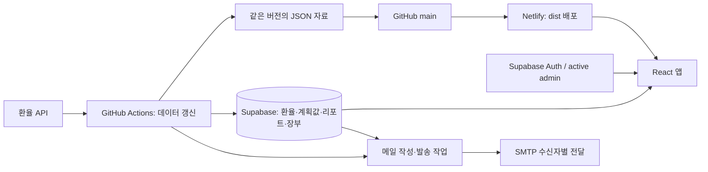
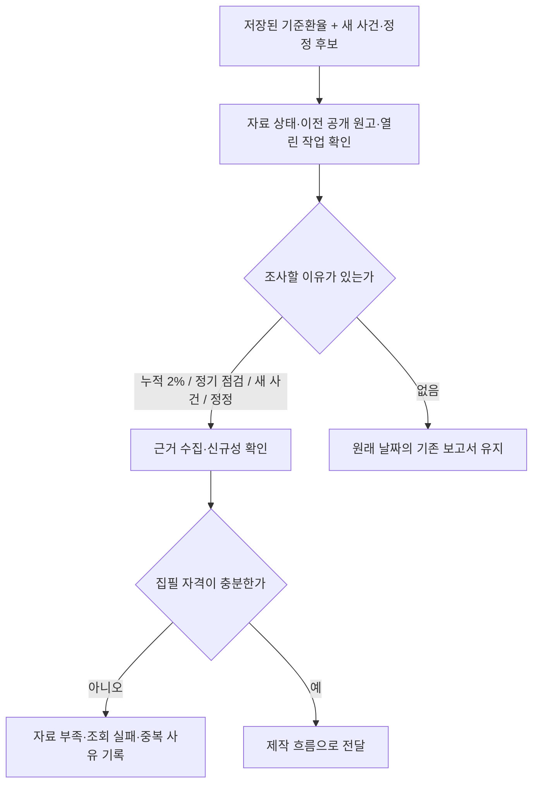
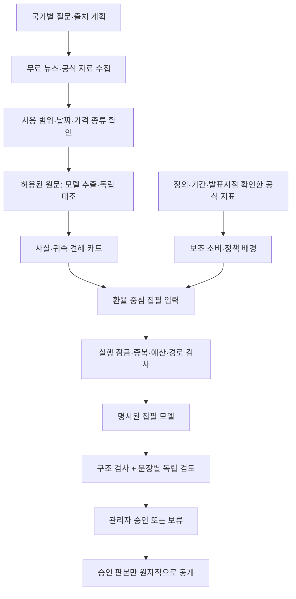
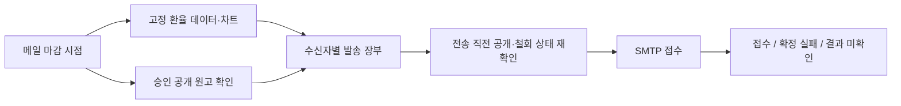

# 설계도와 실행 경로

상태: **로컬 코드 기준**, 운영 적용은 별도. 문서의 화살표는 권한·승인 단계를 생략하는 지름길이 아닙니다.

## 서비스 연결

`src/App.tsx`는 화면을 연결하고 `useExchangeData`가 기존 환율·계획값을 관리합니다. 대시보드와 리포트는 같은 기준환율 선택 정책을 사용합니다. `src/lib/reports`는 목록·상세·이력 조회를 담당합니다. `src/local-report`의 재내보내기 파일은 옛 검증 도구 호환용입니다.

## 발행 판단: 왜 새 원고를 준비하는가

기준은 `shared-price-contract.js`, 판정은 `publication-cadence.js`, 휴일과 저장값의 관계는 `dashboard-reference-state.js`를 사용합니다. 정기 점검일 도래가 강제 발행 승인은 아닙니다.

## 리포트 제작: 무엇을 누구에게 보내는가

자동 운영 진입점은 `scripts/currency-report/operating-entry.js`입니다. 계획(plan)과 실행(execute)을 분리하며, 모드 변경만으로 서버 처리 정책·DB 예산·활성화 조건을 우회할 수 없습니다. `runtime-supply`, `original-news-pipeline`, `runtime-worker`와 관련 모듈을 거칩니다. 기사 속 지시문은 실행하지 않습니다.

## 이메일 전달

새 운영 메일 진입점은 `scripts/send-dashboard-email.mjs`, 상태 처리는 `scripts/email`입니다. legacy와 approved 발송기는 동시에 보내지 않습니다. 새 리포트 작업은 일일 환율·메일 작업 뒤에 분리되므로 이후 승인된 원고는 다음 메일 대상입니다. 메일 발송 장부 장애 시 무기록 발송으로 우회하지 않습니다.
