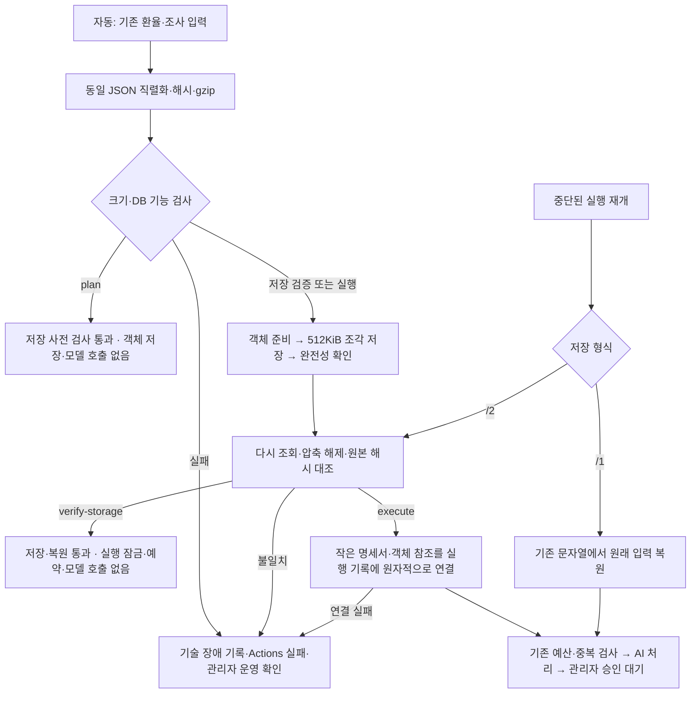

# 자동 리포트 입력 저장·복원

**2026-11-10: 운영 DB·코드 배포와 실제 무과금 저장·복원 통과. 유료 후속 처리 확인은 남아 있습니다.** 배포 기준은 `681de0c`입니다. 이번 변경은 입력의 보관 방법과 장애 표시만 다룹니다. 환율 계산·발행 조건·기사·집필 입력·모델·예산·공개 승인 정책은 변경하지 않습니다.

## 해결한 문제

기존 `/1`은 전체 환율·조사 자료와 그 자료를 문자열로 만든 복원 사본을 같은 실행 행에 넣었습니다. 11월9일 환율 전체 이력만으로 중복 계산값이 52,396,880바이트여서 앱의 30,000,000바이트 검사에 걸립니다. 준비 점검은 이 검사 전에 돌아왔습니다. 실제 운영 실패 로그에는 당시 전체 입력의 바이트 수가 없으므로 아래 재생 수치를 그 실행의 정확한 크기로 부르지 않습니다.

새 `/2`는 기존 JSON 문자열을 그대로 gzip으로 압축해 비공개 DB에 분리 보관하고, 실행 행에는 참조와 해시만 둡니다. 기존 `/1`의 읽기·재개는 유지하며 과거 실행을 변환하지 않습니다.

## 저장과 재개 흐름

이 흐름은 [기존 제작 흐름](architecture.md#조사카드집필검토공개)의 입력 보관 부분에 적용됩니다. 참조나 해시가 잘못되면 최신 자료로 채워 넣지 않습니다. 저장 검증을 통과해도 실행 기록 연결까지 성공한 것은 아니므로 연결 장애는 실제 연결 성공 때만 해결 처리합니다.

## 인터페이스와 보호 한도

| 항목 | 기준 |
| --- | --- |
| 형식 | `operating-frozen-input/2`, 객체 `gzip-json/1` |
| 객체 | 환율 dataset / 조사·집필 준비 prepared; 원본 SHA-256으로 식별 |
| 조각 | 압축 바이트 최대 512KiB, 순번·길이·해시 확인 |
| 실행 명세서 | UTF-8 최대 256KiB; 기존 순서를 유지하는 작은 복원 틀·원본 해시·참조 |
| 실행당 합계 | 압축 전 128MiB, 압축 후 32MiB; 압축 해제 출력도 제한 |
| 쓰기 순서 | 준비 → 조각 → 봉인 → 읽기 복원 대조 → 실행 연결 |
| 재전송 | 같은 식별자·내용은 재사용, 다른 내용은 거절 |
| 권한 | 서버 전용. 익명·일반 사용자·로그인 관리자에게 원문 권한 없음 |
| 보존 | 자동 삭제 없음. 실행 참조는 FK로 보호. 미완성·미참조 용량 별도 집계 |

기존 행의 30MB/32MB 제한을 확대하지 않습니다. 실행 명세서의 작은 직렬화 사본은 기존 복원 계약을 유지하지만 큰 환율·준비 본문은 중복하지 않습니다. 조각 RPC는 기존 15초 제한을 유지합니다.

## 실제 자료와 합성 사례의 검증 결과

이 절은 운영 반영 전 로컬 검증 기록입니다. 당시 추가 모델 비용 **$0**, 신규 유료 예약 **$0**이며 운영 DB·설정·공개 원고를 변경하지 않았습니다. [정제한 로컬 근거](evidence/frozen-storage-verification-20261110.json). 이후 운영 결과는 다음 절과 분리합니다.

| 사례 | 압축 전 | 압축 후 | 명세서 | 의미 |
| --- | ---: | ---: | ---: | --- |
| 실제 11월9일 전체 환율 | 23,933,901 B | 1,674,395 B | 별도 객체 | 원본 순서·바이트 해시 일치 |
| 위 환율 + 저장된 11월2일 6국 준비 자료 | 31,277,528 B | 4,994,955 B | 1,252 B | 기존 중복 계산 67,340,673 B; 날짜가 다른 저장 자료의 조합 재생 |
| 기존 공통 준비 경로의 6국 저장 재생 | 35,646,129 B | 5,142,769 B | 1,287 B | 저장 뉴스·공식 자료, 모의 발행 이력으로 저장 경로 확인. 오늘의 발행 자격·품질 검증 아님 |
| 환율 일간 이력 2배 + 긴 자료 | 54,895,226 B | 6,439,928 B | 1,252 B | 증가량을 만든 합성 사례 |

Node 20.19.0에서 이미 봉인된 실제 조합의 압축·조회·복원 왕복은 약 1.97초, 측정한 개별 RPC 최대 약 25.8ms였습니다. 최초 전체 삽입 시간의 독립 측정값으로 부르지 않습니다. 여러 대형 사례를 연속 처리한 검증 프로세스 최대 RSS는 871,960,576바이트(약 832MiB)였고 운영 프로세스의 최대값은 아직 미측정입니다.

반복 시험 후 새 테이블의 실제 DB 할당량은 18,489,344바이트, 압축 조각 합계는 17,614,810바이트였습니다. 실자료·합성·중단 시험 객체 8개가 누적된 수치이며, 운영 실행 한 번의 DB 증가량으로 해석하지 않습니다. 저장 검증은 실행을 연결하지 않으므로 이 자료들은 미참조로 남습니다. 자동 삭제하지 않았습니다.

검증 항목은 무손실 복원, 잘못된 조각·참조·순서·압축, 상한 경계, 조각 응답 유실·재시작, 기존 `/1` 재개, 요청 본문·입력 해시 동일성, 비용·잠금·동시 실행, 권한 차단, 장애 알림 중복·해결과 링크입니다. 모델 응답은 모의이며 AI 원고 성공으로 세지 않습니다.

전체 앱/서버 테스트 1,411건, DB 검사 26파일 485항목을 통과했습니다. DB 전체 검사는 기존 시험 기록을 지우지 않고 같은 격리 클러스터의 빈 검증 DB에 스키마만 복제해 수행했습니다. 그 DB에서 이전 형태로 되돌린 뒤 최종 추가 migration을 통째로 적용하는 검사도 통과했습니다. 기존 실제 로컬 DB에서는 큰 자료 왕복·로그인 역할별 RPC 차단을 별도로 확인했습니다.

## 실제 운영 저장·복원 확인

[PR #26](https://github.com/erleri/congenial-octo-garbanzo/pull/26)의 최종 CI는 테스트 1,412건 및 DB 검사 485항목을 통과했습니다. 암호화 운영 백업을 별도 로컬 DB로 복원해 82개 테이블과 권한을 대조한 뒤 추가 migration `20261109154806`을 적용했습니다. 원본 파일의 migration 이름은 `20261109150211_currency_operating_frozen_objects.sql`이며 운영 도구가 부여한 적용 버전과 구분합니다.

배포 `681de0c`가 2026-11-10 00:52 KST에 Netlify 운영에 반영됐습니다. [무과금 확인 #1](https://github.com/erleri/congenial-octo-garbanzo/actions/runs/42649524739)은 00:55~00:57 KST에 성공했습니다. [개인정보 없는 운영 근거](evidence/frozen-storage-production-20261110.json).

| 항목 | 실제 운영 결과 |
| --- | --- |
| 입력 | 11월9일 전체 환율 이력 + 새 무료 수집·공식 자료의 6통화 준비 입력 |
| 환율 객체 | 23,933,901 B → 1,674,395 B |
| 준비 자료 객체 | 27,607,745 B → 7,455,586 B |
| 전체 | 51,541,646 B → 9,129,981 B, 약 82.3% 압축 절감 |
| 명세서 | 1,254 B |
| 저장/복원 | 객체 2개·조각 19개 완전 저장, 전체 입력 해시 일치 |
| DB 할당량 | 새 저장 관련 4개 테이블 합계 9,650,176 B. 빈 테이블의 사전 할당량을 별도 측정하지 않아 순증량으로 부르지 않음 |
| 보호 자료 | DB 적용 직후 기존 44개 테이블 해시 일치. 무료 수집 후 갱신 대상 5개를 제외한 환율·원고·회계·메일 등 39개 테이블도 일치 |
| 시간 | 전체 workflow 2분 33초(설치·수집 포함). 저장만의 시간·개별 요청 시간·최대 메모리는 운영에서 별도 계측하지 않음 |
| 비용·부작용 | 모델 호출 0, 신규 유료 예약 0, 실행 잠금 없음, 배치 생성 0, 게시·메일 발송 없음 |

저장 검증은 배치 연결을 하지 않으므로 두 객체는 미참조 상태로 남습니다. 정상 검증 잔여물이며 자동 삭제하지 않습니다. 관리자 로그인·공개 대시보드·기존 승인 6건의 조회도 확인했습니다. 운영 장애를 일부러 주입하지 않았으며 중단·변조·권한·회계 경계의 상세 검사는 격리 로컬 결과입니다.

Actions 요약의 `자료 보류 (storage_verified)`는 **저장은 통과했지만 일부 출처 공백이 있다는 복합 상태**입니다. PEN 일부 접근 실패와 MXN·CLP의 조회 횟수 제한/후보 없음은 남지만 다른 출처로 준비를 계속했습니다. 이를 저장 실패 또는 원고 합격으로 해석하지 않습니다.

이번 준비 결과는 6통화 조사 후보·기사 입력 20건, 최대 52회·$6.988400001입니다. 모두 누적 ±2% 미만이고 정기 점검 예정일은 11월16일입니다. 새 자료의 중요성은 아직 내용 검토 전이므로 6개 발행을 보장하지 않습니다. 01:06 KST에 전환용 일시 보류(revision 4)를 해제해 기존 자동 생성 설정을 복원했습니다(revision 5). 월 $30·실행 $7 한도는 유지하며 지금 별도 유료 작업을 실행하지 않았습니다. 다음 예약 실행은 최신 입력의 발행 필요성과 예산을 다시 검사합니다. 기존 미확정 2건의 전액 예약 $0.34849는 보존됐고, 이번 비용은 $0입니다.

## 장애와 운영자 행동

| 결과 | 의미·처리 |
| --- | --- |
| 대상 없음 | 기존 발행 조건 유지, 저장 시험을 위해 발행을 강제하지 않음 |
| 저장 사전 검사 통과 | 직렬화·크기·DB 기능 조회 성공. 실제 저장 성공과 구분 |
| 저장·복원 통과 | 객체 왕복 완료. 예산 예약·실행 잠금·모델 호출 없음 |
| 기술 장애 | 사전 검사/쓰기/복원/실행 연결 단계를 기록, 새 유료 처리 중단 |
| 관리자 검토 대기 | 기존 AI 처리 이후 원고 검토·승인은 그대로 유지 |

같은 단계·같은 원인의 지속 장애는 한 항목으로 갱신합니다. 확인 시각·횟수만 바뀌어 새 메일 버전이 되지 않습니다. 정상 검사가 해당 단계를 통과해야 해결되며, 객체 저장 성공만으로 연결 장애를 숨기지 않습니다. DB에 장애 기록조차 남기지 못하면 작업 실패와 기록 실패를 Actions에 표시합니다. 리포트 작업 실패는 전체 실행에도 실패로 드러나지만 앞서 끝난 환율·독자 메일을 취소하거나 재실행하지 않습니다.

## 운영 반영·복구 순서

1. 검증 커밋·추가 DB 변경 1건·PR/CI·배포·무과금 저장 확인의 적용 범위를 승인받습니다. 문서화 커밋 `503f4e4`와 이번 실행 코드 변경을 구분합니다.
2. 리포트 생성만 일시 보류하고 진행 중 호출·미확정 예약을 다시 읽습니다. 환율·기존 공개본·독자 메일 설정은 유지합니다.
3. 운영 백업과 복원 확인 후 추가형 DB migration을 적용합니다. 데이터 삭제나 기존 migration 병합은 하지 않습니다.
4. CI 통과 코드 배포 후 기능·권한·관리자 조회를 확인합니다. 최종 운영 자료로 무과금 저장·복원을 확인합니다. 대상 없음이면 그것을 정상으로 기록하고 저장 검사와 새 생성의 검증 범위를 분리합니다.
5. 최신 입력·발행 대상·비용 상한을 다시 확인한 후 승인된 운영 예산·처리 조건 안에서 실행합니다. 이번 로컬 재생의 6국 계획 수치를 운영 실행 예산으로 재사용하지 않습니다.
6. 문제 시 새 유료 실행을 보류하고 `/2`를 읽을 수 있는 코드·원본·회계를 유지합니다. 테이블 삭제, `/2` 미지원 코드로 무조건 복귀, 다른 입력의 재생성은 복구 방법이 아닙니다.

운영 저장·복원과 대상 통화의 후속 처리가 확인되기 전에는 장애 수정 전체 완료로 표시하지 않습니다. 운영 응답시간·DB 증가량·실비/예약도 별도로 기록해야 합니다.

## 구현과 재현 위치

- [직렬화·압축·복원](../../scripts/currency-report/operating-storage.js), [공통 운영 경로](../../scripts/currency-report/operating-cycle.js), [실행 진입점](../../scripts/currency-report/operating-entry.js)
- [추가 DB 변경](../../supabase/migrations/20261109150211_currency_operating_frozen_objects.sql), [DB 권한·회계 검사](../../supabase/tests/currency_report_frozen_storage.sql)
- [저장·장애 검사](../../scripts/currency-report/operating-storage.test.ts), [실제 저장 자료 재생](../../scripts/currency-report/verify-operating-storage.js), [빈 스키마 DB 회귀 검사](../../scripts/currency-report/verify-storage-schema-local.js)

실자료 재생 스크립트는 기존 비공개 로컬 DB 계정 파일과 특정 보존 실행을 사용하는 이 작업 환경용입니다. 기본 운영 명령이 아니며 키·원문·계정 파일을 복사해 배포하지 않습니다. 일반 공통 경로의 무과금 왕복 명령은 `report:operate -- --action verify-storage`입니다.
