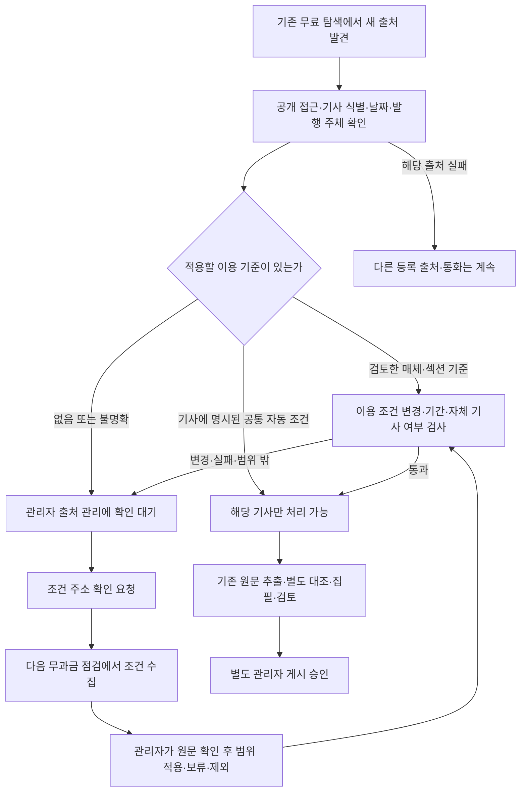

# 운영·개발 안내

**출처 관리 운영 반영 검토 — 11월8일:** 신규 매체 점검이 기존 자료 수집 전에 시간을 소진할 수 있던 문제를 로컬에서 보완했다. 기존 6통화 수집을 먼저 끝낸 뒤 새 출처 처리에 최대 30초를 배정하며, 느린 조회·저장·늦은 응답을 검증했다. **운영 미반영**이며 다음은 새 후보의 원격 CI와 반영 승인이다. [검토 결과와 해소 조건](#출처-관리-운영-반영-검토--2026-11-08)을 확인한다.

**미등록 매체 관리 — 11월8일 로컬 보강:** [기사 단위 격리·후보 기록·자료 공백에 따른 제한 점검](#미등록-뉴스-출처-관리--2026-11-08-로컬-구현)을 추가했습니다. 이 변경은 운영 미반영입니다. 아래 과거 준비 기록의 로컬/미반영 표시는 해당 기록 시점의 상태입니다. PR #21과 이후 [무과금 data-check](https://github.com/erleri/congenial-octo-garbanzo/actions/runs/42476809431)는 이미 운영에서 확인했으며, 자동 생성 잠금은 유지합니다.

**최신 상태 — 11월8일:** PR #20 반영 후 실제 data-check에서 환율 갱신·복구·DB/공개 자료 일치를 확인했습니다. 후속 [자료 공백 점검](source-gap-review-20261108.md)에서 PEN 요청 배분과 CLP 응답 재사용을 로컬 보강했고, MXN 미발표·ARS 재게시 의견을 구분했습니다. 이 후속 코드는 운영 미반영이며 생성 잠금과 기존 메일은 유지합니다. 아래 과거 준비 기록과 실제 실행 결과는 [반영 이력](release-readiness-20261104.md)으로 구분합니다.

추가 [자동 운영 공통 경로 보강](unattended-operation-completion-20261108.md)에서 저장 자료의 전면 장애 재사용·국가별 저장 실패 격리·예산 내 대기 작업 보존과 재개를 구현하고 반복 검증했습니다. 로컬 후보이며 새 배포·활성화는 하지 않았습니다.

**11월8일 후속 발행 기준 정정 — 로컬 구현:** 사용자의 확정 지시에 따라 정기 점검은 실제 업로드·승인일이 아닌 리포트 기준일+14일 이후 첫 월요일(당일 포함)입니다. 11월2일자 공개본의 다음 점검일은 **11월16일**이며, 아래 과거 점검의 11월23일은 이전 코드 결과입니다. 누적 변화는 유효 공개본에 고정된 환율을 분모로 계산합니다. 현재 역사값의 갱신·조회 기간 이탈만으로 비교를 중단하지 않습니다. 단위·가격 정의·확인된 공급자 변경 및 현재 자료 오류 검사는 유지합니다. 늦게 승인된 오래된 원고는 더 최근 기준일의 공개본을 밀어내지 않습니다. 공통 코드/정책 버전은 각각 `publication-cadence/3`, `six-currency-cadence/3`이며 기존 가격 스냅샷·공개 이력·원고와 운영 설정은 변경하지 않았습니다. 현재 기준은 [공통 규칙](rules.md)을 따릅니다.

## 환경 구분

| 환경 | 역할 | 이번 정비의 권한 |
| --- | --- | --- |
| 운영 GitHub·Netlify·Supabase | 현재 사용자 서비스 | 11월8일 승인한 초기 설정·DB24개·PR #18 병합/배포 완료. 추가 생성·메일 활성화는 별도 범위 |
| 로컬 기본 앱 | 앱 개발·빌드 | 코드 정리와 무과금 검사 |
| 격리 로컬 DB·A안 | 원고·승인·조회 시험 | 기존 원고와 검토 이력 보존 |
| 과거 시험 자료 | 회귀·비용·복구 증거 | 참조 확인 후 비공개 보관, 승인 이력 승격 금지 |

## 안전한 실행 시작점

- 앱 검증: README 명령표. `npm run check`는 제품 회귀이며 AI 품질 표본 수가 아닙니다.
- 자동 리포트: `npm run report:operate -- --action plan`은 서버 설정·자료를 확인하는 무과금 준비 경로입니다. 외부 무료 자료 조회와 로컬/서버 상태 접근 가능성이 있으므로 완전 오프라인 테스트와 혼동하지 않습니다.
- `--action execute`는 명시된 처리 정책·활성화·예산·대상 범위가 준비된 뒤 사용합니다. 이번 청소에서는 실행하지 않습니다.
- 메일: `legacy`, `shadow`, `approved`의 의미를 [메일 연결 검증](../2.0/email-integration-20261103.md)에서 확인합니다. shadow는 기존 메일이 실제 발송될 수 있습니다. 전체 일일 Actions 수동 실행을 무발송 점검으로 사용하지 않습니다.
- 과거 날짜가 들어간 `run-*`, `prepare-*`, `verify-*`는 자동 운영 명령이 아닐 수 있습니다. 실행 전 코드의 환경·쓰기·외부 호출 범위를 확인합니다.

## 운영 전환의 남은 항목

[최신 T1–T5 점검표](release-readiness-20261104.md)를 전환 목록으로 사용합니다. [11월3일 원문](../2.0/operating-final-check-20261103.md)은 당시 증거로 보존합니다. 11월8일 실제 운영 DB 암호화 백업·격리 복원, GitHub 초기 잠금 설정과 INEGI Secret 등록, DB24개 추가와 PR #18 운영 배포를 완료했습니다. 기존 수신자는 유지합니다. 운영 관리자 로그인은 사용자가 확인했고 이후 기존6개 원고도 운영에서 승인되어 공개6건입니다. 새 자동 생성 활성화와 메일 전환은 아직 남았습니다.

11월8일 후속 승인으로 서버 반복 처리 정책1건과 월$30·실행당$7/60회·요청당$0.25를 등록했습니다. 회사 지원 한도$5는 추후 조정 사항이며 아직 적용하지 않았습니다. 마지막6개 실제 원고를 원래11월2일 기준일·근거·검토·과거 원가와 함께 운영 승인 대기 목록으로 복사했습니다. 로컬 승인·계정은 복사하지 않았으며 공개6건은 사용자의 별도 운영 승인 결과입니다.

현재 생성 제어는 `enabled=false / review_enabled=false / monthly limit=30`, Actions는 `currency / review / plan / hold=true`입니다. 11월8일 배포된 동일 수집·판정 코드와 운영 DB로 실제 무과금 자료 확인을 수행했습니다. 후보27건·공식 수치7건을 확보했으나 BRL/MXN의 기존 발행 기준값 불일치, CLP/PEN 보조지표와 일부 뉴스 접근 실패가 남았습니다. 상세 원인과 가격은 최신 점검표를 따릅니다. 실행 시작은 로컬이므로 GitHub runner의 실제 Secret 인증·예약 성공을 검증한 것은 아닙니다. 메일은 `legacy / send approved=false / hold=false`로 유지하며 신규 AI 호출·비용·메일은0입니다.

## 일별 채택 환율과 출처 보존 — 로컬 구현

11월8일 사용자가 선택한 방식은 기존 공급자 선택을 유지하면서 **대시보드에서 채택한 값이 나중에 다른 역사 응답으로 조용히 교체되지 않게 하는 것**입니다. 다음은 로컬 구현이며 아직 운영 배포하지 않았습니다.

- `generate:data`가 직전 `data/fx-full-history.json`을 먼저 읽습니다. 새 응답을 기존 방식으로 구성한 뒤 날짜·통화·가격 종류별 첫 채택값을 유지합니다. 당일 재실행도 같은 값은 교체하지 않습니다. 공급자·가격 정의·제공 날짜·수집 시각·응답 해시는 확인된 범위만 함께 보존합니다. 회사 공식 환율이나 현지 종가로 격상하지 않습니다.
- 새 응답의 값이 다르면 원래 값과 제시된 값·출처를 `referenceArchive.revisionOffers`에 남깁니다. 같은 변경 제안은 재수집 시각만 달라졌다고 중복 적재하지 않습니다. 이는 검토 자료이며 숫자 정정·원고 수정·관리자 승인을 자동 실행하지 않습니다.
- 휴일 값은 기존 `FFILL`을 재사용합니다. 보존한 원관측값에서 다시 연결하고, 이월값을 휴일의 새 API 관측으로 저장하지 않습니다. 월평균·원화 환산·이동 비교도 보존한 일별 값과 맞춥니다. 이미 채택한 원화 환산값은 그대로 보존합니다.
- 전체 보관 기록은 기존 전체 데이터 파일에 추가합니다. 새 DB 테이블이나 별도 작업 실행은 없습니다. 기존 Actions의 데이터 파일 커밋과 Supabase 숫자 동기화 경로를 재사용합니다. 브라우저용 `public/data.json`은 기존400일 숫자·필요한 출처만 전달하고 전체 보관 기록을 중복 전달하지 않습니다. 기존5MB 쓰기 전 제한도 유지합니다.
- 직전 전체 파일이 없거나 손상됐거나400일 제한본이면 임의 초기화하지 않고 갱신 오류로 남깁니다. 기존 데이터 버전 해시와 보관 기록 해시를 검사합니다. 해시는 변조 방지 서명이 아니라 파일 일관성 검사입니다. 실패 시 기존 정상 배포·DB 자료를 유지하고 복구 절차로 확인합니다.
- 일반 새로고침은 최초 진입과 같은 운영 저장소·정적 대체 경로를 다시 읽습니다. 브라우저가 외부 환율 API를 직접 조합해 다른 숫자를 선택하지 않습니다. Excel 업로드는 기존의 명시적인 로컬 임시 보기이며 운영 기준을 바꾸지 않습니다. 늦게 끝난 이전 요청이 새 요청 결과를 덮지 않도록 구분합니다.

최초 도입 때는 직전 저장본이 실제로 채택한 기준일의 값만 보존합니다. 공급자 기록이 없으면 `미확인` 상태를 유지합니다. 과거 전체 날짜를 현재 공급자로 소급 확정하지 않습니다. 과거 복구는 아래의 별도 증거 검사를 거칩니다.

### 과거 채택값 복구 — 로컬 검증 완료, 운영 미반영

`scripts/prepare-reference-recovery.ts`는 외부 조회 없이 Git에 남은 전체 저장본과 저장한 공개 리포트 조회 결과를 대조합니다. 역사 커밋이 지정한 실제 배포 커밋의 조상인지, 원시 파일 SHA-256·Git blob·전체 데이터 버전 해시가 맞는지 확인합니다. 공개 리포트가 현재 active이고 통화·기준일·관측일·단위·수집 시각·대표값·전일값·등락 계산·차트 전체 점이 맞아야 복구 기록을 만듭니다. 제한된 브라우저 파일이나 리포트에 적힌 숫자만으로 만들지 않습니다.

준비 명령에는 `--historical-commit`, `--production-commit`, `--sha256`, `--public-reports`, `--output`을 명시합니다. 출력은 신규 파일로만 생성해 기존 기록을 덮지 않습니다. 확정할 복구 기록은 `data/reference-recoveries.json`에서 관리하고 실제 자료 갱신 시 공통 보관 함수에 전달합니다. 이 파일에는 원문·관리자 정보·비밀값 없이 채택 행·공개 리포트 ID와 해시·Git 근거만 담습니다. 현재 로컬 파일은 운영 반영 승인 전 검토 대상입니다.

이미 고정한 같은 날짜·가격 종류와 값이 다르면 복구도 중단합니다. 최초 복구가 적용된 뒤에는 같은 기록을 다시 적용해도 중복되지 않습니다. 원화 환산값과 그 계산에 사용한 USD/KRW도 함께 보존합니다. 휴일 이월·월평균·이동 비교·대표 숫자는 기존 공통 계산 경로로 다시 구성합니다. 복구 기록 전체는 서버용 전체 데이터에만 두며 브라우저에 중복 전달하지 않습니다.

11월2일 공개6건은 각각 차트400개 점까지 당시 전체 저장본과 일치했습니다. 로컬 재생에서 BRL/MXN의 대표값·원화 환산값4개 셀만 달라졌고, 최신일 값·다른 통화 값·원고·공개 승인 시각은 그대로입니다. 두 통화의 `anchor_value_revised`가 해소됐으며6통화 모두 누적2% 미만이고 정기 점검일은11월23일입니다. 이는11월7일 저장 가격·11월8일 승인 이력으로 판단한 결과입니다. 향후 값·사건이 달라지면 다시 판정합니다. 당시 공급자는6건 모두 미확인으로 유지합니다. 같은 날짜 CNY의 별도 차이는 이번6개 리포트 복구 범위 밖이라 영향표에 남겼고 변경하지 않았습니다.

### DB 반영과 확인

환율 DB의 기존 최근7일 증분 범위는 유지합니다. 다만 검증된 복구 행, 그 행에서 이어진 휴일 이월 행, 영향을 받은 월평균은 날짜가 오래돼도 추가 동기화합니다. 다음 실제 관측부터는 과거 복구 범위에서 제외해 전체 이력을 매일 다시 올리지 않습니다. 같은 계산 입력은 중복하지 않습니다. `fx-recovery-sync.js`를 동기화와 검증이 함께 사용하며 복구 행·이월값·월평균이 누락되거나 달라지면 실패로 남깁니다. 검증은 일반 표본 외에 복구 대상 전부와 데이터 버전·ready 상태를 확인합니다.

코드 배포만으로 운영 가격을 고치지는 않습니다. 이후 기존 자료 갱신에서 보관·복구 파일을 생성하고 DB에 동기화한 뒤, 그 자료 커밋이 배포되어야 정적 대체 자료까지 같아집니다. 상세 반영 순서와 보존 조건은 [이번 반영 검토](reference-rollout-review-20261108.md)를 따릅니다.

## 메일 없는 자료 갱신·점검 — 운영 반영·실행 확인

Daily Dashboard Email의 수동 실행에 `run_scope=data-check`를 추가했다. 예약 실행과 옵션을 지정하지 않은 기존 수동 실행은 `daily`로 유지한다. 이 옵션은 main에서만 허용한다. 11월8일 PR #20 병합·배포 후 main에서 data-check 1회를 실행해 두 job의 성공과 메일/모델 step 생략을 확인했다.

1. 기존 API로 전체/대체 환율 자료를 갱신한다. 기존 채택값 보관·검증된 과거 복구·휴일 이월 계산을 사용한다.
2. 기존 Supabase 환율 동기화·검증 후 자료 커밋을 만든다. 이 모드에서 DB 연결이 없으면 JSON만 만들고 성공 처리하지 않는다. 자료 커밋의 Netlify 배포도 확인해야 한다.
3. 같은 자료 커밋을 별도 runner에서 읽고 `npm run report:operate -- --action plan --require-ready`로 6통화 무료 자료 수집·발행 판정을 확인한다. 공식 입력 캐시·수집 상태·정정 검토 후보 기록은 기존 DB 경로에 저장된다. 공개 원고는 고치지 않는다.
4. 6통화의 대표 환율과 전회 비교가 모두 준비되어야 가격 준비 검사를 통과한다. 빠진 통화·중복·비교 보류는 실패다. 일부 뉴스 접근 실패와 근거 부족은 별도 상태로 남으며 가격 준비 통과가 내용 품질/집필 자격 승인을 뜻하지 않는다.

이 모드에서는 메일 작성·수신자 조회·두 발송 경로·구/신 모델 집필 경로가 모두 실행되지 않는다. 모델 키도 무료 점검 step에 주입하지 않는다. Actions hold·DB 생성 잠금·예산·메일 변수는 변경하지 않는다. 새 비용 예약·원고 생성·승인·공개는 없다. 별도 점검 job은 20분 제한이며 실패를 숨기지 않는다. 기존 정기 메일과 일일 작업의 동시 실행 방지 설정은 유지한다.

추후 수동 실행할 때는 main과 `data-check` 선택을 확인한다. 완료 후 DB/정적 자료 버전·복구 행/월평균·공개6건 해시·계획환율·잠금 보존과 메일/모델 step 생략을 실제 로그로 대조한다. 실패한 job 전체를 무조건 재실행하지 않고 어느 자료/동기화 단계가 반영됐는지 먼저 확인한다.

## 장애와 복구

환율 갱신·계획환율 저장·기존 메일의 정상 경로를 우선 보존합니다. 리포트 실패는 사유와 비용을 남기고 새 작성만 보류합니다. 결과 미확정 호출·SMTP 전송은 무작정 재실행하지 않습니다.

[복구 절차](../2.0/recovery-runbook.md)를 따릅니다. 공개 코드 오류는 수정/되돌림 커밋을 정상 CI로 적용하며, 코드 복구를 위해 운영 DB 전체를 과거로 덮어쓰지 않습니다. 신규 계획값·승인·정정·철회·발송·비용 장부를 보존합니다.

## 정리와 용량

`node scripts/maintenance/inventory.mjs`는 코드·문서의 정적 참조와 크기 목록을 만들며 삭제하지 않습니다. 정적 참조가 없다는 이유만으로 미사용으로 결론내리지 않습니다. `node scripts/maintenance/verify-docs.mjs`는 현재 안내 문서의 로컬 링크를 확인합니다.

배포 파일, Git 이력, 로컬 시험 자료, DB, Actions 보관량은 각각 측정합니다. 보관소로 옮긴 양과 삭제·압축으로 줄어든 디스크 사용량을 구분합니다. 자동 만료·운영 삭제는 활성화하지 않습니다. 키와 비공개 원고를 Git에 포함하지 않습니다.
# 미등록 뉴스 출처 관리 — 2026-11-08 로컬 구현

상태: 로컬 구현과 저장·합성 자료 검증. 운영 DB 적용, 코드 배포, 자동 생성 활성화는 하지 않았다. 기존 환율·원고·근거·비용 기록을 보존한다.

## 일상 처리

1. 등록 출처의 기존 무료 수집을 먼저 실행한다. 읽은 목록·기사에 있는 환율 관련 외부 링크에서 후보를 기록한다. 새 검색 서비스나 모든 웹사이트를 순회하는 탐색은 추가하지 않는다.
2. 미등록 기사와 등록 ID가 맞지 않는 기사는 해당 자료만 제외한다. 새 사건 후보·정정 검사·유료 원문 분석·집필 입력에도 넘어가지 않는다. 등록된 정상 자료는 계속 처리한다.
3. 후보는 국가·도메인 기준으로 합치고 `www` 별칭을 정규화한다. 도메인은 매체의 실제 발행 주체가 확인됐다는 뜻이 아니다. 원문과 제목을 복제하지 않고 대표 URL·발견 경로·최초/최근 발견·처리 상태만 보관한다.
4. 등록 자료 미확보, 세 날짜 이상 반복 조회 실패, 동일 본문·같은 명시 원매체 의존, 이전 내용 검토의 설명 부족이 있을 때만 후보 기술 점검을 진행한다. 이는 조사 필요성이지 집필 자격 판정이 아니다.
5. 저장 응답이 있으면 해시를 확인해 재사용한다. live 모드에서는 통화당 한 후보의 robots와 대표 페이지를 최대 두 번 조회한다. 재시도·리디렉션·로그인·유료벽 우회·모델 호출은 없다. 한 요청의 DNS·응답 합산 제한은 6초이며 응답은 robots 200KB, 페이지 2MB 이하로 제한한다. 새 도메인은 공개 IPv4에 연결을 고정해 내부 주소 접근을 막는다.
6. 후보 요약은 기술 확인과 이용 판단을 구분한다. 추가 이용 판단 경로는 아래의 공통 자동 기준과 관리자 재사용 기준을 적용한다. 기술 조회 성공만으로 이용·본문 지지·게시를 승인하지 않는다. 원문은 후보/관리자 DB에 저장하지 않으며 실제 수집 이후 기존 비공개 원문 검토 경로에서만 처리한다.

## 상태와 다음 행동

| 상태 | 의미 | 처리 |
| --- | --- | --- |
| candidate_only | 기존 탐색에서 발견한 후보 | 근거 공백이 있을 때만 점검 |
| conditions_unconfirmed | 접근·메타데이터 점검 후에도 사용 범위 미확인 | 기존 출처 등록 절차의 검토 대상으로 유지 |
| temporary_failure | robots·HTTP·DNS·응답 제한 등 기술 실패 | 1·3·7·30일 간격으로 재확인. 같은 실행에서 재시도하지 않음 |
| processing_excluded | robots 제한·대기 요구·유료벽 확인 | 해당 처리를 제외하고, 다음 확인 시점에 조건을 새로 점검 |
| 등록 출처 반복 실패 | 같은 UTC 날짜의 반복 실행은 한 번으로 계산한 실패가 세 날짜 이상 | 기존 관리자 상태판에서 지속 장애 표시. 다른 정상 자료는 처리 |
| 후보 저장 실패·동시 갱신 | 후보 관리 정보가 최신으로 저장되지 않음 | 기존 조회 상태에 이유 표시. 등록 출처의 집필 자격을 대신 승인하거나 차단하지 않음 |

재확인 간격은 기술 점검 간격이며 콘텐츠 삭제 기한이 아니다. 같은 저장 응답의 반복 검사는 생략한다. 실제 live 재확인은 다음 시점 이후 새 응답으로 수행한다. 단일 실행의 기술 검사 최대 2건, 새 HTTP 요청 최대 2회/통화다. 기존 기사 수집 예산과 후보 점검 요청 수를 따로 기록한다. 6통화에서 새 요청은 최대 12회이며 유료 비용은 0이다.

후보는 국가당 최대 32개, DB는 6개 국가의 작업용 요약 행만 유지한다. 상한을 넘는 후보는 생략 수를 명시해 관리자에게 보이며, 기존 기록이나 원고를 자동 삭제하지 않는다. 승인·근거·비용의 감사 이력과 이 작업용 요약을 혼동하지 않는다. 종합 보존 기간의 기존 제안을 이번 작업으로 자동 적용하지 않는다.

기존 `originHints`의 명시된 원매체와 동일 캡처 해시는 편중·중복 점검 신호다. 같은 매체·사건의 독립성을 자동 입증하지 않으며, 기존 원문·주장 대조가 최종 판단을 담당한다.

## 연결 구조와 적용 경계

`selected-source-collection` → 외부 링크 후보 기록 → `source-candidates`의 자료 공백·저장 응답 검사 → `source-candidate-probe`의 제한된 live 기술 조회 → 비공개 `currency_report_source_monitors` → 기존 관리자 리포트 상태판.

본문은 후보 관리 DB와 공개 화면에 전달하지 않는다. 후보 URL의 인증 정보·쿼리·내부 주소는 제외한다. 후보 목록은 active admin만 조회한다. 관리자 결정도 외부 매체의 허가를 만들어내거나 예산·게시 잠금을 바꾸지 않는다. 저장은 이전 binding/결정 버전을 확인하므로 동시 실행의 오래된 결과가 새 상태를 덮지 못한다.

신규 매체의 실제 사용은 아래 경로로 공통 수집·원문 대조·집필에 연결한다. 특정 매체의 추가 등록 없이도 기존 근거가 충분하면 리포트 제작은 계속된다.

운영 반영 시에는 `20261108120546_currency_report_source_monitor.sql`과 `20261108124341_currency_report_source_admission.sql` 적용 및 코드 배포를 함께 검토한다. 이번 작업은 로컬 구현이며 운영 반영은 하지 않는다. 스키마가 없으면 출처 관리 연결 실패가 표시되고 기존 등록 출처 처리는 계속된다. 자동 생성 활성화·유료 실행·메일 발송은 이번 변경에 포함하지 않는다.

검증은 저장·합성 입력과 격리 DB 구조 복사본에서 수행했다. 실제 새 매체의 이용 허용이나 실제 AI 품질 통과를 주장하지 않는다. 상세 검사 기록은 비공개 `.local-reports/private/source-monitor-20261108/`에 둔다.

## 출처의 자동 적용과 관리자 예외 처리 — 로컬 구현

**기준은 매체·섹션 단위로 재사용하고, 기사별 적합성은 매번 검사한다.** 기존 등록부는 유지한다. 신규 출처만 서버가 저장한 판정 근거와 관리자 결정을 읽어 임시 수집 목록에 추가한다. 국가별 특별 문구나 특정 매체 이름에 의존하는 허용 규칙은 없다.

### 운영자가 결정하는 위치

기존 관리자 로그인 → **연결·수집 상태 → 출처 관리**. 같은 active admin 권한을 사용한다. 일반 로그인, 로그아웃, 관리자 권한 해제 상태에서는 조회·변경을 허용하지 않는다.

1. **매체·섹션 기준 준비:** 확인된 자체 기사, 적용 경로, 같은 매체의 이용 조건 URL을 지정한다. `/economia/`와 `/`는 범위가 다르다. 요청만으로 활성화되지 않는다.
2. **자동 조건 조회:** 다음 무료 자료 점검이 robots와 조건 페이지를 확인한다. 원문 전문 대신 확인 시각·내용 해시·짧은 발췌만 관리 저장소에 남긴다. 조회 실패를 정상 조건으로 대체하지 않는다.
3. **이 범위에 적용 / 보류 / 제외:** 운영자가 조건 원문을 읽고 수집·비공개 AI 분석·독립 사실/견해 활용 범위와 판단 이유를 기록한다. 조건의 최신 해시가 일치해야 저장된다. 사용자 판단 자체가 외부 매체의 허가를 대신하지 않는다.
4. **다음 기사 자동 적용:** 같은 정확한 호스트·경로·발행 주체의 자체 공개 기사만 재사용 기준을 적용한다. 명시된 다른 제공자, 전재 출처, 유료 접근, 수집 제한, 기사 식별 실패는 이 범위로 우회하지 않는다. 기사별 제외·보류가 있으면 우선한다. 겹치는 섹션은 더 좁은 경로의 결정을 적용한다.
5. **이력 확인:** 최근 기사별·매체별 결정을 각각 100건까지 화면에 표시한다. 이전 결정·판정 근거는 비공개 감사 기록으로 보존한다. 수집 프로그램은 운영자 결정을 생성하거나 덮어쓸 권한이 없다.

### 자동 조건과 재확인

- 기사 자체의 정확한 JSON-LD에 CC BY 4.0 또는 CC0 1.0이 명시되고 발행 주체·본문·날짜·공개 접근·표시 조건이 확인되면 해당 기사만 자동 처리 후보로 인정한다. 사이트 바닥글의 라이선스나 ‘무료로 열림’만으로 이용을 인정하지 않는다. 제공된 저자·제목·표시 조건·라이선스 링크와 독립 정리 사실을 근거 연결에 전달한다.
- 그 외 매체는 운영자가 확인한 범위를 재사용한다. 자동 모델이 이용 조건을 스스로 승인하지 않는다. 새 매체의 모든 사이트 구조를 자동 지원한다는 뜻은 아니다. 지원하지 않는 구조는 기술 확인 필요 상태로 남긴다.
- 기사 판정 근거는 7일 이내, 매체 기준은 적용 후 최대 90일 이내다. 매체의 조건은 무료 점검에서 최근 24시간 내 확인값을 사용한다. 변경·조회 실패·만료 시 해당 범위를 보류한다. 24시간 사이에 일어난 변경을 실시간 감지한다고 주장하지 않는다.
- 조건 조회는 통화별 실행당 최대 8개 범위, 범위당 robots+조건 페이지 최대 2회다. 최근 확인이 있는 범위는 재조회하지 않고 오래된 확인부터 검사한다. 국가를 번갈아 처리하고 동일 시점의 대기 항목 순서는 매일 회전한다. 같은 조건 URL·robots 응답은 해당 실행에서 재사용한다. 초과분은 확인 대기이며 임의 승인하지 않는다. 기존 기사 수집·후보 점검·조건 조회의 요청 수를 분리한다. 이 한도는 운영 실측 후 조정할 설정이며 무제한 탐색이 아니다.
- 실행 순서는 **기존 등록 6통화 수집 → 새 출처 설정 조회·조건 확인·보조 기사 수집 → 발행 판정과 집필 준비**다. 새 출처 단계 전체는 경과시간 기준 최대 30초이며 조건 갱신은 그중 최대 10초다. 기한이 지난 조건을 갱신한 출처도 같은 실행에서 보조 수집할 수 있다. 기존 매체·공식 통계를 다시 조회하지 않으며 통화별 전체 뉴스 요청 상한 32회를 함께 지킨다. 오래된 조건의 재사용이나 자동 승인을 대체 경로로 사용하지 않는다.
- 시간 한도에서는 진행 중인 새 출처 HTTP·DB 요청에 취소를 전달하고 다음 새 요청을 시작하지 않는다. 늦게 도착한 결과로 이번 집필 입력을 변경하지 않는다. 조건 갱신·보조 수집의 미완료는 관리자 연결 상태에 다음 점검 대기로 표시한다. 서버에서 취소 직전에 완료된 조건 기록은 다음 조회에서 확인할 수 있지만 관리자 승인 기록을 자동 변경하지는 않는다. 이 30초는 기존 자료 수집 전체의 제한이나 전체 일일 작업의 완료 보장이 아니다.
- 활성 기사 후보는 통화당 최대 8개, 현재 판정 포인터는 통화당 32개, 매체 범위는 통화당 24개다. 만료된 판정 포인터는 작업 목록에서 빠지되 원래 근거와 결정 이력은 삭제하지 않는다. 매체 정책은 원본 설정 변경 없이 별도 저장된다.
- 새 기사 수집은 기존 등록 매체의 요청 배분을 유지한 뒤 남는 한도로 수행한다. 자동 수집 전체 상한 32회에 도달하면 보조 출처를 다음 점검으로 미루며, 기존 출처를 덜 조회하고 ‘뉴스 없음’으로 처리하지 않는다. 명시적으로 더 작은 한도를 지정한 실행도 그 한도를 넘기지 않는다.
- 기사 본문·이용 조건이 같고 화면 주변 장식만 바뀌면 새 조건으로 오판하지 않도록 본문 메타데이터와 실제 캡처 해시를 구분한다. 본문·출처·권리 표시가 달라지면 새 검토가 필요하다.

### 호출·저장 경계

준비한 실행에는 출처 상태를 고정한다. 실제 각 모델 요청을 예약하기 전에 최신 출처 상태를 다시 읽어 제외·범위 축소·조건 변경을 확인한다. 확인 실패 시 해당 출처를 포함한 통화의 새 요청을 멈추며, 나머지 통화의 정상 경로는 유지한다. 이미 전송된 요청을 되돌리지는 못하며 확인과 전송 사이의 짧은 경합까지 완전히 제거했다고 주장하지 않는다.

환율 발행 기준, 월/배치 예산, 모델·ZDR·데이터 수집 제한, 중복 생성 방지, 독립 원문 검토, 게시 승인은 기존 경로를 재사용한다. 신규 출처 관리 기능은 이 잠금을 해제하지 않는다. 원문 전체·키·관리자 신원은 출처 관리 API나 공개 번들로 전달하지 않는다.

검증 자료: `.local-reports/private/source-admission-20261108/`. 합성 기사로 관리자 결정의 DB 왕복, 다음 기사 재사용, 조건 변경·권한 해제·호출 전 제외와 기존 6통화 제작 경로를 확인한다. 실제 저장 기사 재생은 원고·캡처 해시 보존을 검사한다. 모의 모델의 성공은 실제 매체 이용 허가나 실제 생성 품질의 증거가 아니다.

## 출처 관리 운영 반영 검토 — 2026-11-08

대상은 `1484a84`와 `bda4980` 두 로컬 커밋이며, 운영 main `cdb808e` 대비 45개 파일이다. 이번 검토는 읽기 전용 운영 확인과 로컬 검사이며 push·배포·운영 DB 적용·유료 호출·메일 발송은 하지 않았다.

| 확인 항목 | 결과 |
| --- | --- |
| 현재 운영 | GitHub main과 실제 공개 앱의 빌드 표시가 `cdb808e`로 일치. 운영 페이지 HTTP 200 |
| 공개 원고·제어 | 11월2일자 6통화 공개 상태 active. 생성·자동 검토 비활성, 월 $30·실행 $7·요청 $0.25, 진행 중 실행 0건 |
| 배포 후보 단독 검사 | 커밋만 별도 폴더에 추출. 동일 package/lock의 설치 패키지를 재사용해 타입·린트·전체 테스트·앱/리포트 빌드·번들 경계 통과. 원격 CI는 아직 미실행 |
| 저장 구조 | 운영에 신규 출처 테이블은 아직 없음. monitor → admission 순서의 migration 2개 필요. 기존 원고·환율·관리자·예산·메일 구조 변경 없음 |
| 권한·복구 | 기존 active admin을 사용. 로컬 DB 436개 검사와 보안 점검 통과. 되돌릴 때 신규 이력을 삭제하지 않고 새 코드만 되돌림 |
| 시간 초과 보완 | 기존 등록 6통화 수집 후 새 출처를 처리. 설정 조회·조건·보조 수집 전체 최대 30초, 그중 조건 갱신 최대 10초. 중복 조회 재사용·취소·다음 점검 대기 연결 완료 |

**이전 후보에서 발견한 문제:** `bda4980`의 `planAutomaticSupply`는 6통화 기존 자료 수집을 시작하기 전에 `refreshSourceTerms` 전체를 기다렸다. 통화당 8개 범위, 범위당 HTTP 2회·각 6초, 저장 요청 15초 제한이지만 전체 조회의 시간 한도가 없었다. 48개 범위에서 HTTP가 제한 직전에 응답하고 저장이 시간 초과하는 가상 지연 재생은 약 21.6분이었다. `data-check` 작업의 전체 20분보다 길다. 이는 실제 운영에서 21.6분을 측정했다는 뜻이 아니라 당시 허용한 개별 한도 안에서 재현한 지연 누적이다.

**로컬 보완과 검증:** 기존 수집을 먼저 끝내고 새 출처 처리 전체에 시간 한도를 적용했다. 가상 타이머로 설정 조회·원문 조회·조건 저장·보조 기사 수집이 끝나지 않는 경우를 검증했다. 48개 조건 범위가 있어도 기한 이후 새 요청이 시작되지 않으며 미확인 조건은 적용되지 않는다. 기한이 지난 조건을 갱신한 기사 한 건은 기존 수집을 반복하지 않고 같은 실행의 검토 입력까지 연결됐다. 보조 수집이 늦게 끝나도 이미 반환한 판정은 바뀌지 않는다. HTTP 취소가 DNS 이후의 새 요청 시작까지 막는지 별도로 확인했다. 기존 원고·환율·예산·승인·메일 설정은 변경하지 않았다.

보완 뒤 반영 순서는 **새 후보 커밋 검증 → 검토 PR·CI → 최신 백업 및 운영 기준점 재확인 → migration 2개 적용 → 코드 병합·Netlify 배포 → 관리자 권한·무과금 연결 점검**이다. 각 운영 동작은 별도 승인 범위로 진행한다. 생성 잠금·기존 메일은 유지한다. 현재 점검에서 읽은 원고 해시·정책을 반영 직전/직후 다시 비교한다. 반영 이후에도 실제 신규 매체의 조건 확인과 실제 모델 품질을 합성 검사로 대신하지 않는다.

코드 회귀 시 최신 환율 자료를 보존한 코드 되돌림 커밋으로 복구한다. 신규 테이블·감사 이력·기존 공개 원고는 삭제하지 않는다. 검토 근거는 비공개 `source-admission-20261108/release-verification.json`, `live-build.json`, `rollout-latency-review.json`에 있다.
